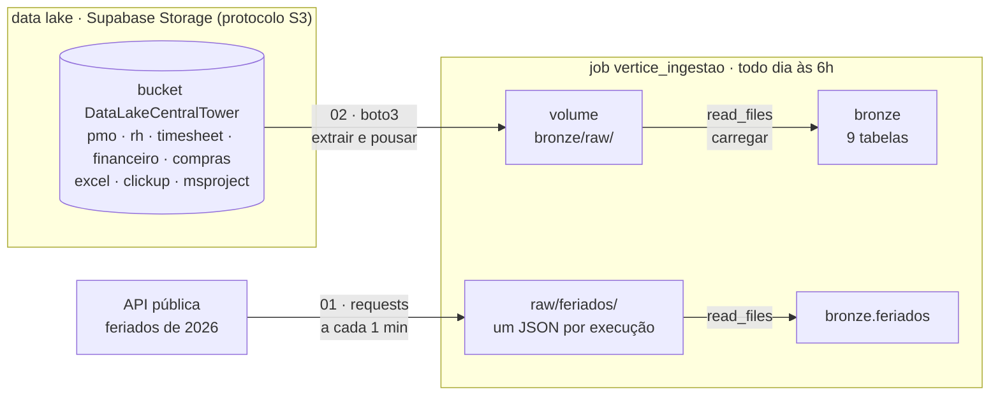
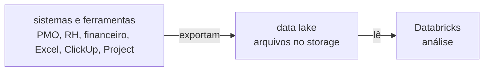

# 🛠️ Noite 2: Engenheiro de Dados | Imersão Jornada de Dados

**Terça, 20/10/2026, 19h30.**

**Ao fim desta noite você terá** as 9 tabelas da bronze recriadas **por código**, vindas de onde o dado
mora numa empresa de verdade: o **data lake** (um storage S3, aqui o Supabase), mais uma **API** de fora.
E um job que repete tudo sozinho, todo dia às 6h.

**Por que isso importa:** ontem você baixou os arquivos e subiu na mão. Funciona uma vez. Numa empresa, o
dado não está no seu computador: os sistemas e as ferramentas exportam tudo para um data lake, e chega dado
novo toda semana. Ir buscar, sem ninguém olhar, é o trabalho do engenheiro de dados.

> 📺 **Pergunta da noite:** *"E se o dado não estiver no meu computador?"*
> **Amanhã:** com a bronze vindo sozinha, o Claude Code transforma tudo em silver e gold ([noite 3](../aula-03-modelagem-claude-code)).

---

## 🏗️ O desenho da noite



| Bloco | Tempo | O que acontece |
|---|---|---|
| Aquecimento de Python | 20 min | variáveis, listas, dicionários, `for`, funções, `requests`, `pandas` e `boto3` |
| Teoria | 15 min | data lake, protocolo S3, extrair-pousar-carregar, a regra da bronze |
| API → bronze + job | 20 min | os feriados: a ingestão mais simples, num job que roda a cada 1 minuto |
| Data lake → raw → bronze | 30 min | o `boto3` traz os arquivos para o raw e o `read_files` recria as 9 tabelas |
| Job completo | 5 min | o data lake entra no mesmo job, que passa a rodar todo dia às 6h |

A noite **termina na bronze**. Limpar, juntar as três ferramentas e calcular os KPIs é amanhã, com o
Claude Code.

---

## 🧠 A teoria, em 5 ideias

**1. Onde o dado mora.** O sistema que roda a operação guarda tudo num banco transacional, feito para
gravar e ler poucas linhas muito rápido. Ninguém roda análise pesada ali. Os sistemas e as ferramentas
**exportam arquivos** para um storage barato na nuvem, o **data lake**, e a plataforma analítica lê de lá.



**2. O protocolo S3.** O S3 é o storage de arquivos da AWS e virou o padrão do mercado: quase todo storage
fala o mesmo protocolo, inclusive o do Supabase. O `boto3` é a biblioteca da AWS; com o `endpoint_url`
apontando para o Supabase, **o mesmo código funciona na Amazon**.

| Termo | O que é | Aqui |
|---|---|---|
| Bucket | a pasta raiz, o "balde" | `DataLakeCentralTower` |
| Key | o caminho do arquivo dentro do bucket | `pmo/projetos.csv` |
| Endpoint | o endereço do serviço | `https://ahebbqgjfrhrytognoew.storage.supabase.co/storage/v1/s3` |
| Access key / secret | o usuário e a senha da máquina | no ambiente: `AWS_ACCESS_KEY_ID` e `AWS_SECRET_ACCESS_KEY` |

**3. Extrair, pousar, carregar.** Buscar na origem, guardar uma cópia do jeito que veio (o **raw**, no
volume) e só então transformar em tabela (a **bronze**). É **ELT**: carrega primeiro, transforma depois.
Com o raw guardado, reprocessar não exige buscar tudo de novo.

**4. A bronze não limpa nada.** Ela guarda o que chegou. A vírgula decimal, a data em dois formatos e o
status escrito de 12 jeitos continuam lá: são evidência do que a origem mandou. Por isso tudo entra como
**texto**. Limpar é a silver, amanhã. E é **idempotente**: rodar duas vezes dá o mesmo resultado que uma
(`CREATE OR REPLACE`), então o job pode repetir sem medo.

**5. Credencial não vai no código.** O notebook lê as chaves do ambiente (`os.environ`), e quem preenche é o
job, pelos parâmetros. Um passo além, em produção: guardar a chave num *secret scope* do Databricks.

---

## 🔌 Os dados de conexão

| Variável (parâmetro do job) | Valor |
|---|---|
| `S3_ENDPOINT` | `https://ahebbqgjfrhrytognoew.storage.supabase.co/storage/v1/s3` |
| `AWS_DEFAULT_REGION` | `us-east-2` |
| `AWS_ACCESS_KEY_ID` | passada na aula |
| `AWS_SECRET_ACCESS_KEY` | passada na aula |

O bucket é `DataLakeCentralTower` (maiúsculas e minúsculas contam). Esses valores entram como **Job parameters** (etapa 4) ou nas caixinhas do topo do
notebook, quando você roda na mão.

---

## 🚀 Passo a passo

### 0. Antes de começar

- **Computação serverless** em todos os notebooks: ela tem acesso à internet e já traz o `boto3`.
- **Conta verificada.** A Free Edition só acessa a internet com a conta verificada. Se aparecer
  `ConnectionError` ou `Max retries exceeded`, verifique a conta quando o Databricks pedir.
- **Três notebooks**, um por etapa. O código de cada um está logo abaixo, célula por célula, com botão de
  copiar. Nesta pasta, cada etapa tem duas versões: com lacunas, para fazer junto, e o gabarito, com o
  código pronto. Para abrir no Databricks: **Workspace › Import › URL** com o link "raw" do arquivo no GitHub.

### 1. Aquecimento de Python (20 min)

No Databricks: **New › Notebook**, nome `00_aquecimento_python`, computação **serverless**. Cole uma célula de
cada vez e rode com **Shift+Enter**. Prefere com lacunas para resolver? Importe o
[`00_aquecimento_python.py`](00_aquecimento_python.py) (exercícios) e confira no
[`00_aquecimento_python_gabarito.py`](00_aquecimento_python_gabarito.py). Tente entender cada linha antes de rodar: os comentários explicam.

#### 1. Variáveis e tipos

Uma variável é um nome para um valor. O Python descobre o tipo sozinho; o `type()` mostra qual.

*Célula 1*

```python
projeto = "PRJ-011"             # str  · texto sempre entre aspas
total_projetos = 60             # int  · número inteiro, sem aspas
carteira_mi = 305.2             # float· número com casas decimais (ponto, não vírgula)
em_andamento = True             # bool · True ou False, com inicial maiúscula

for valor in (projeto, total_projetos, carteira_mi, em_andamento):
    print(valor, type(valor))
```

##### f-string

O `f` antes das aspas liga a interpolação; o que está entre chaves é avaliado como código.

*Célula 2*

```python
print(f"A Vértice tem {total_projetos} projetos e R$ {carteira_mi} mi de carteira.")

# formatando dinheiro no padrão brasileiro: milhar com ponto, centavos com vírgula
valor_contrato = 12500000.0
print(f"Contrato: R$ {valor_contrato:,.2f}".replace(",", "X").replace(".", ",").replace("X", "."))
```

#### 2. Listas

Uma lista guarda vários valores em ordem, entre colchetes. O índice começa em 0.

*Célula 3*

```python
# os 4 projetos com o pior SPI da carteira (noite 1)
piores = ["PRJ-016", "PRJ-030", "PRJ-039", "PRJ-011"]

print(f"São {len(piores)} projetos")
print("O pior:  ", piores[0])
print("O último:", piores[-1])     # índice negativo conta de trás para frente

ferramentas = ["excel", "clickup", "msproject"]
print("ferramentas:", ferramentas)
```

#### 3. Dicionários

Um dicionário guarda pares **chave: valor**. É assim que uma API, um banco ou um JSON devolvem cada
registro: um projeto é um dicionário.

*Célula 4*

```python
projeto = {
    "projeto_id": "PRJ-011",
    "nome": "Checkout e meios de pagamento",
    "ferramenta": "msproject",
    "pct_concluido": 54,      # quanto está pronto
    "pct_esperado": 70,       # quanto devia estar pronto hoje
}

spi = projeto["pct_concluido"] / projeto["pct_esperado"]
print(f"SPI do {projeto['projeto_id']}: {spi:.2f}")      # 0.77: abaixo de 1 é atraso
```

##### Dicionário dentro de dicionário

Leia de fora para dentro: `projeto["cliente"]` devolve outro dicionário, e nele pedimos `["segmento"]`.

*Célula 5*

```python
projeto = {"projeto_id": "PRJ-011",
           "cliente": {"nome": "Supermercado Bom Preço", "segmento": "varejo"}}

print(projeto["cliente"]["segmento"])
```

#### 4. `for` e `if`

O `for` repete o mesmo passo para cada item; o `if` escolhe o caminho.

*Célula 6*

```python
cronogramas = ["PRJ-002", "PRJ-010", "PRJ-012"]

for prj in cronogramas:
    print(f"Baixando Cronograma {prj}.xlsx do data lake...")
```

*Célula 7*

```python
# a regra da Vértice: SPI abaixo de 0,8 é crítico; abaixo de 0,9, atenção
spis = {"PRJ-016": 0.63, "PRJ-030": 0.69, "PRJ-039": 0.75, "PRJ-011": 0.77, "PRJ-024": 0.91}

for prj, spi in spis.items():
    if spi < 0.8:
        print(f"{prj}  SPI {spi}: crítico")
    elif spi < 0.9:
        print(f"{prj}  SPI {spi}: atenção")
    else:
        print(f"{prj}  SPI {spi}: ok")
```

#### 5. Funções

`def` cria a função, os parâmetros vão entre parênteses e o `return` devolve o resultado. O texto entre
três aspas é a documentação da função. Escreveu uma vez, usa para os 60 projetos.

*Célula 8*

```python
def calcular_spi(pct_concluido, pct_esperado):
    """Índice de prazo: quanto está pronto dividido por quanto devia estar. Abaixo de 1 é atraso."""
    return round(pct_concluido / pct_esperado, 2)


def situacao(spi):
    """A regra de corte da Vértice."""
    if spi < 0.8:
        return "crítico"
    if spi < 0.9:
        return "atenção"
    return "ok"


spi = calcular_spi(54, 70)
print(spi, situacao(spi))                # 0.77 crítico
print(calcular_spi(75, 100), situacao(calcular_spi(75, 100)))   # 0.75 crítico
```

#### 6. Métodos: cada tipo traz as suas funções

Um **método** é uma função que já vem grudada no valor: você escreve o valor, um **ponto** e o nome.
Cada tipo tem os seus: o texto sabe ficar em minúsculas, a lista sabe crescer, o dicionário sabe listar as
chaves. No notebook, digite o valor, o ponto e aperte **Tab** para ver todos.

| Tipo | Métodos que você vai usar | O que fazem |
|---|---|---|
| `str` | `.lower()` `.upper()` `.strip()` `.replace(a, b)` `.split(sep)` `.startswith(x)` | minúsculas, maiúsculas, tirar espaços, trocar, quebrar, começa com |
| `list` | `.append(x)` `.sort()` `.count(x)` | acrescentar, ordenar, contar |
| `dict` | `.keys()` `.values()` `.items()` `.get(chave, padrão)` | as chaves, os valores, os pares, ler sem dar erro |

A sujeira da Vértice, que ontem você viu no SQL, se resolve com métodos de texto:

*Célula 9*

```python
# o farol do gerente veio escrito de vários jeitos
farol = "  VERDE "
print(farol.strip().lower())                   # "verde": um método depois do outro (encadeamento)

# o custo veio com vírgula decimal: para o Python, isso é texto, não número
valor = "12345,67"
print(float(valor.replace(",", ".")))          # 12345.67

# o projeto está escondido no nome do arquivo
arquivo = "Cronograma PRJ-002.xlsx"
print(arquivo.split(" ")[1].replace(".xlsx", ""))   # "PRJ-002"
print(arquivo.startswith("Cronograma"))             # True
```

*Célula 10*

```python
# lista: acrescentar, contar e ordenar
farois = ["verde", "amarelo", "verde"]
farois.append("vermelho")                      # a lista cresce no lugar
print(farois.count("verde"))                   # 2
farois.sort()
print(farois)                                  # ['amarelo', 'verde', 'verde', 'vermelho']

# dicionário: chaves, valores e o .get, que não quebra se a chave não existir
projeto = {"projeto_id": "PRJ-011", "cliente": "Supermercado Bom Preço", "spi": 0.77}
print(list(projeto.keys()))
print(projeto.get("cpi", "sem CPI"))           # "sem CPI", em vez de KeyError
for chave, valor in projeto.items():
    print(f"{chave}: {valor}")
```

**Objetivo:** a lista abaixo tem o farol de 5 status. Deixe todos iguais (sem espaço, minúsculos) e conte
quantos são verdes.

*Célula 11*

```python
status = [" Verde", "VERDE", "verde ", "Amarelo", "vermelho"]

limpos = [s.strip().lower() for s in status]   # o mesmo método para cada item
print(limpos)
print(limpos.count("verde"), "verdes")         # 3
```

> **Guarde esta ideia para o pandas:** uma tabela do pandas também tem métodos (`df.head()`,
> `df.describe()`) e uma coluna de texto tem os mesmos métodos do `str`, depois de um `.str`:
> `df["farol"].str.strip().str.lower()`. É o `.lower()` desta seção, aplicado à coluna inteira de uma vez.

#### 7. Bibliotecas

*Célula 12*

```python
import requests
import pandas as pd

print("pandas", pd.__version__)
print("requests", requests.__version__)
```

#### 8. Consumindo uma API

A Vértice atende clientes no Brasil inteiro. A API pública do IBGE devolve os 27 estados com a região de
cada um. `status_code` 200 significa "deu certo"; o `raise_for_status()` interrompe a execução se vier
erro, o que evita seguir o pipeline com dado vazio.

*Célula 13*

```python
URL_IBGE = "https://servicodados.ibge.gov.br/api/v1/localidades/estados"

resposta = requests.get(URL_IBGE, timeout=60)
resposta.raise_for_status()

estados = resposta.json()          # JSON vira lista de dicionários

print("status:", resposta.status_code)
print("estados recebidos:", len(estados))
print("primeiro:", estados[0])
```

#### 9. pandas

*Célula 14*

```python
# a lista de dicionários vira tabela; o json_normalize abre o dicionário "regiao" em colunas
df_estados = pd.json_normalize(estados)[["sigla", "nome", "regiao.nome"]]
df_estados = df_estados.rename(columns={"regiao.nome": "regiao"})
display(df_estados.head())

print("formato (linhas, colunas):", df_estados.shape)
print("colunas:", list(df_estados.columns))

# contagem por região: o GROUP BY do pandas
por_regiao = df_estados.groupby("regiao").size().sort_values(ascending=False)
print(por_regiao)

# filtro: o WHERE do pandas
display(df_estados[df_estados["regiao"] == "Norte"])
```

#### 10. boto3: lendo arquivos do data lake

O **boto3** é a biblioteca da AWS para falar com o **S3**, o serviço de arquivos na nuvem. O Storage do
**Supabase** fala o mesmo protocolo, então o mesmo código serve para os dois: muda só o `endpoint_url`.

| Termo | O que é |
|---|---|
| **Bucket** | A pasta raiz, o "balde" |
| **Key** | O caminho do arquivo dentro do bucket, por exemplo `pmo/projetos.csv` |
| **Endpoint** | O endereço do serviço |
| **Access key / secret** | Usuário e senha da máquina |

Aqui, no aquecimento, a chave fica no código para ficar simples de ver. No notebook de ingestão ela sai
do código e passa a chegar pelo ambiente (`os.environ`).

*Célula 15*

```python
import boto3

# os valores estão na tabela de conexão, no começo deste README
S3_ENDPOINT = "https://ahebbqgjfrhrytognoew.storage.supabase.co/storage/v1/s3"
S3_REGION = "us-east-2"
S3_BUCKET = "DataLakeCentralTower"

ACCESS_KEY = "COLE-AQUI"     # passada na aula
SECRET_KEY = "COLE-AQUI"     # passada na aula

from botocore.config import Config

s3 = boto3.client(
    "s3",
    endpoint_url=S3_ENDPOINT,
    region_name=S3_REGION,
    aws_access_key_id=ACCESS_KEY,
    aws_secret_access_key=SECRET_KEY,
    config=Config(s3={"addressing_style": "path"}),   # o Supabase só entende o bucket no caminho da URL
)

# Listar buckets
response = s3.list_buckets()

for bucket in response["Buckets"]:
    print(bucket["Name"])
```

Agora os arquivos de dentro do bucket. A resposta é um dicionário: os arquivos ficam em `Contents`, e
cada um tem `Key` (o nome) e `Size` (o tamanho em bytes).

*Célula 16*

```python
response = s3.list_objects_v2(Bucket=S3_BUCKET)

for objeto in response["Contents"]:
    print(f"{objeto['Key']:<30} {objeto['Size']:>10,} bytes")

# a forma curta, com list comprehension
arquivos = [objeto["Key"] for objeto in response["Contents"]]
print("\narquivos:", arquivos)
```

#### 11. De bytes para tabela

O `get_object` devolve um dicionário; o conteúdo está em `Body`, e o `.read()` transforma em bytes. O
pandas espera um arquivo, e o que temos são bytes na memória: o `io.BytesIO` finge ser um arquivo.

*Célula 17*

```python
import io

objeto = s3.get_object(Bucket=S3_BUCKET, Key="pmo/projetos.csv")
conteudo = objeto["Body"].read()
print(f"{len(conteudo):,} bytes baixados")

df_projetos = pd.read_csv(io.BytesIO(conteudo))
print(df_projetos.shape)
display(df_projetos.head())
```

#### Erros comuns neste aquecimento

| Erro | O que aconteceu |
|---|---|
| `IndentationError` | Faltou o recuo de 4 espaços dentro do `for`, do `if` ou da função |
| `NameError: name 'x' is not defined` | A variável não existe: você rodou a célula fora de ordem |
| `KeyError: 'regiao'` | A chave não existe no dicionário; confira a grafia |
| `KeyError: 'Contents'` | O bucket está vazio ou o nome está errado |
| `ConnectionError` ao chamar a API | Conta do Databricks ainda não verificada |
| `EndpointConnectionError` | Endpoint errado; confira o endereço do Storage |
| `InvalidAccessKeyId` / `SignatureDoesNotMatch` | Chave ou segredo errados |

#### Fechando o aquecimento

Se você resolveu os 11 exercícios, tem tudo o que precisa para a aula:

- sabe guardar valores e percorrer listas;
- entende a resposta de uma API e a de um storage S3;
- sabe transformar bytes em tabela com o pandas;
- conhece as bibliotecas que o pipeline usa.

Siga para o **`01_ingestao_api`**: a primeira ingestão da noite, a dos feriados.

---

### 2. API → bronze (20 min)

A primeira ingestão da noite, e a mais simples: uma API pública, sem chave. Na empresa, o dado não chega
pronto: alguém precisa ir buscar. Quando a fonte não tem conector, entra o Python, sempre em três passos:
**extrair** (pedir à API), **pousar** (guardar o arquivo no raw, do jeito que veio) e **carregar** (o
`read_files` transforma o arquivo em tabela).

**Pergunta de negócio:** quantos dias úteis a Vértice perde em novembro, bem quando começa o change freeze
da Black Friday (01/11)?

No Databricks: **New › Notebook**, nome `01_ingestao_api`, computação **serverless** (ela tem internet).
Cole uma célula de cada vez. Com lacunas para fazer junto: [`01_ingestao_api.py`](01_ingestao_api.py) · código pronto:
[`01_ingestao_api_gabarito.py`](01_ingestao_api_gabarito.py).

#### Passo 1 · Extrair: pedir os feriados à API

*Célula 1*

```python
import requests                # conversa com a API (HTTP)

url = "https://brasilapi.com.br/api/feriados/v1/2026"
resposta = requests.get(url, timeout=30)
resposta.raise_for_status()    # se a API cair, para aqui com o erro, em vez de seguir com nada

feriados = resposta.json()     # o JSON vira uma lista do Python: um dicionário por feriado
print(len(feriados), "feriados")
feriados[:3]
```

#### Passo 2 · Pousar: o JSON numa pasta nova do raw

Cada execução grava um arquivo **novo**, com a data e a hora no nome. O raw guarda o histórico de
tudo o que chegou: dá para saber o que a API respondia em cada momento.

*Célula 2*

```python
import json, os
from datetime import datetime

pasta = "/Volumes/lakehouse_vertice/bronze/raw/feriados"
os.makedirs(pasta, exist_ok=True)                        # a pasta nova precisa existir

agora = datetime.now().strftime("%Y-%m-%d_%H-%M-%S")     # ex.: 2026-10-20_19-40-00 (horário UTC)
with open(f"{pasta}/feriados_{agora}.json", "w") as arquivo:
    json.dump(feriados, arquivo, ensure_ascii=False)

sorted(os.listdir(pasta))                                # um arquivo por execução
```

#### Passo 3 · Carregar: o raw vira a bronze

O mesmo `read_files` da noite 1, lendo **todos** os arquivos da pasta. Duas colunas a mais contam de onde
e de quando veio cada linha.

*Célula 3*

```sql
%sql
CREATE OR REPLACE TABLE lakehouse_vertice.bronze.feriados
COMMENT 'Feriados nacionais de 2026, da BrasilAPI. Uma captura por execução do job.'
AS SELECT date AS data, name AS feriado, type AS tipo, weekday AS dia_da_semana,
          _metadata.file_name              AS arquivo,
          _metadata.file_modification_time AS coletado_em
FROM read_files('/Volumes/lakehouse_vertice/bronze/raw/feriados/', format => 'json', multiLine => true)
```

#### Passo 4 · Conferir

*Célula 4*

```sql
%sql
-- uma linha por captura: 14 feriados em cada uma
SELECT arquivo, coletado_em, COUNT(*) AS feriados
FROM lakehouse_vertice.bronze.feriados
GROUP BY arquivo, coletado_em
ORDER BY coletado_em DESC
```

*Célula 5*

```sql
%sql
-- a resposta para o negócio, na captura mais recente:
-- 02/11 (segunda), 15/11 (domingo) e 20/11 (sexta): 2 dias úteis a menos em novembro
SELECT data, feriado, dia_da_semana
FROM lakehouse_vertice.bronze.feriados
WHERE arquivo = (SELECT MAX(arquivo) FROM lakehouse_vertice.bronze.feriados)
  AND data BETWEEN '2026-11-01' AND '2026-11-30'
ORDER BY data
```

#### Passo 5 · Um job que roda isso sozinho, a cada 1 minuto

1. **Jobs & Pipelines › Create › Job**, nome `vertice_ingestao`.
2. Tarefa `api`: tipo **Notebook**, o seu `01_ingestao_api`, computação **Serverless**.
3. **Schedules & Triggers › Add trigger › Scheduled**, modo **Advanced**, cron `0 * * * * ?`
   (a cada 1 minuto), fuso America/Sao_Paulo.
4. **Run now** para não esperar a primeira rodada.

Espere 2 ou 3 minutos e rode de novo as células 4 e 5: o raw ganhou um arquivo por execução e a
bronze, 14 linhas por captura. Ninguém clicou em nada. **É isso que um engenheiro de dados entrega.**

Cada execução leva uns 4 minutos: a computação serverless do job sobe do zero a cada rodada. Por isso,
com o agendamento a cada 1 minuto, as execuções esperam na fila e rodam uma atrás da outra. Depois de
conferir, clique em **Pause** no agendamento: na etapa 4, o job passa a rodar uma vez por dia.

---

### 3. Data lake → raw → bronze (30 min)

Um notebook novo, `02_ingestao_boto3`, serverless. Com lacunas para fazer junto:
[`02_ingestao_boto3.py`](02_ingestao_boto3.py) · código pronto: [`02_ingestao_boto3_gabarito.py`](02_ingestao_boto3_gabarito.py). O mesmo extrair-pousar-carregar da API, agora
para o data lake inteiro. As 4 caixinhas do topo recebem os valores da tabela de conexão.

Ontem você baixou os arquivos e subiu no volume **na mão**. Numa empresa, os sistemas e as
ferramentas exportam tudo para um **data lake**: um storage na nuvem que fala o protocolo **S3** da AWS.
Aqui o data lake é o Storage do Supabase, e o código é exatamente o que você usaria na Amazon:
muda só o `endpoint_url`.

Os três passos de toda ingestão:
1. **extrair** · o `boto3` lista e baixa cada arquivo do bucket `DataLakeCentralTower`
2. **pousar** · cada arquivo vai para o volume, no mesmo caminho: `/Volumes/lakehouse_vertice/bronze/raw/`
3. **carregar** · o mesmo `read_files` de ontem transforma o raw nas 9 tabelas da bronze

Rode com a computação **serverless**, uma célula de cada vez.

#### Configuração: as chaves chegam pelo ambiente

A chave **não fica escrita no código**. O notebook lê tudo de `os.environ`, as variáveis de ambiente,
como em qualquer servidor ou na própria AWS. Quem preenche os valores é o **job**: cada parâmetro do job
chega ao notebook como um *widget* com o mesmo nome, e a célula abaixo passa os widgets para o ambiente.

- **Rodando na mão:** aparecem 4 caixinhas no topo do notebook. Cole os valores da tabela de conexão.
- **Rodando pelo job:** os valores vêm dos **Parameters** da tarefa (etapa 4). Ninguém digita nada.
- **Ou pelo campo Environment variables (Beta)** da tarefa: aí os valores já chegam no `os.environ`, e a
  célula usa direto, sem caixinha.

Os nomes `AWS_ACCESS_KEY_ID` e `AWS_SECRET_ACCESS_KEY` são o padrão da AWS: o `boto3` encontra as chaves
sozinho no ambiente, sem você passar no código.

*Célula 1*

```python
import os

VARIAVEIS = ["S3_ENDPOINT", "AWS_DEFAULT_REGION", "AWS_ACCESS_KEY_ID", "AWS_SECRET_ACCESS_KEY"]

for nome in VARIAVEIS:
    if os.environ.get(nome):                       # já veio do job (Environment variables)? usa esse
        continue
    dbutils.widgets.text(nome, "")                 # senão, a caixinha (o job preenche pelos Parameters)
    os.environ[nome] = dbutils.widgets.get(nome)   # e o valor vira variável de ambiente

faltando = [nome for nome in VARIAVEIS if not os.environ[nome]]
assert not faltando, f"preencha: {faltando}"      # para aqui se faltar alguma chave

S3_BUCKET = "DataLakeCentralTower"
RAW = "/Volumes/lakehouse_vertice/bronze/raw"
print("ambiente pronto:", os.environ["S3_ENDPOINT"])
```

#### Passo 1 · Conectar no data lake

Repare: nenhuma chave no código. O `boto3` lê `AWS_ACCESS_KEY_ID`, `AWS_SECRET_ACCESS_KEY` e
`AWS_DEFAULT_REGION` do ambiente; só o endereço do Supabase vai explícito.

*Célula 2*

```python
import boto3
from botocore.config import Config

s3 = boto3.client(
    "s3",
    endpoint_url=os.environ["S3_ENDPOINT"],
    config=Config(s3={"addressing_style": "path"}),   # o Supabase só entende o bucket no caminho da URL
)

for bucket in s3.list_buckets()["Buckets"]:
    print(bucket["Name"])
```

#### Passo 2 · O que tem no bucket?

Cada arquivo é um objeto com uma **Key** (o caminho) e um **Size**. O S3 devolve no máximo 1.000
por página; o *paginator* busca todas as páginas.

*Célula 3*

```python
objetos = []
for pagina in s3.get_paginator("list_objects_v2").paginate(Bucket=S3_BUCKET):
    objetos += pagina.get("Contents", [])

# só arquivos (o storage cria um objeto vazio de marcação em cada pasta)
arquivos = [o["Key"] for o in objetos if not o["Key"].endswith("/") and o["Size"] > 0
            and not o["Key"].endswith(".emptyFolderPlaceholder")]

from collections import Counter
for pasta, n in sorted(Counter(k.split("/")[0] for k in arquivos).items()):
    print(f"{pasta:<12} {n:>3} arquivos")
print(f"{'total':<12} {len(arquivos):>3}")
```

#### Passo 3 · Apague o trabalho manual de ontem

É proposital: as pastas do raw e as 9 tabelas da bronze somem, e voltam vindas do data lake.

*Célula 4*

```python
TABELAS = ["projetos", "status_semanal", "excel_tarefas", "clickup_tarefas", "msproject_tarefas",
           "colaboradores", "apontamentos", "custos", "entregas_fornecedor"]

for tabela in TABELAS:
    spark.sql(f"DROP TABLE IF EXISTS lakehouse_vertice.bronze.{tabela}")

for pasta in sorted({k.split("/")[0] for k in arquivos}):
    dbutils.fs.rm(f"{RAW}/{pasta}", True)
    print("apagada:", f"{RAW}/{pasta}")
```

#### Passo 4 · Extrair e pousar: cada arquivo do bucket vai para o raw

*Célula 5*

```python
import os

def baixar(key):
    destino = f"{RAW}/{key}"                                   # o mesmo caminho do bucket
    os.makedirs(os.path.dirname(destino), exist_ok=True)
    conteudo = s3.get_object(Bucket=S3_BUCKET, Key=key)["Body"].read()   # 1 · extrair
    with open(destino, "wb") as f:                                        # 2 · pousar
        f.write(conteudo)
    return len(conteudo)

total = 0
for key in arquivos:
    total += baixar(key)
print(f"{len(arquivos)} arquivos, {total/1e6:.1f} MB no raw")
```

#### Passo 5 · Carregar: o raw vira a bronze, com o mesmo SQL de ontem

Tudo como texto, sem limpar nada: a bronze guarda o que chegou. A limpeza é amanhã, na silver.

*Célula 6*

```sql
%sql
CREATE OR REPLACE TABLE lakehouse_vertice.bronze.projetos AS
SELECT * EXCEPT (_rescued_data)
FROM read_files('/Volumes/lakehouse_vertice/bronze/raw/pmo/projetos.csv',
                format => 'csv', header => true, inferColumnTypes => false);

CREATE OR REPLACE TABLE lakehouse_vertice.bronze.status_semanal AS
SELECT * EXCEPT (_rescued_data)
FROM read_files('/Volumes/lakehouse_vertice/bronze/raw/pmo/status_semanal.csv',
                format => 'csv', header => true, inferColumnTypes => false);

CREATE OR REPLACE TABLE lakehouse_vertice.bronze.colaboradores AS
SELECT * EXCEPT (_rescued_data)
FROM read_files('/Volumes/lakehouse_vertice/bronze/raw/rh/colaboradores.csv',
                format => 'csv', header => true, inferColumnTypes => false);

CREATE OR REPLACE TABLE lakehouse_vertice.bronze.apontamentos AS
SELECT * EXCEPT (_rescued_data)
FROM read_files('/Volumes/lakehouse_vertice/bronze/raw/timesheet/apontamentos.csv',
                format => 'csv', header => true, inferColumnTypes => false);

CREATE OR REPLACE TABLE lakehouse_vertice.bronze.custos AS
SELECT * EXCEPT (_rescued_data)
FROM read_files('/Volumes/lakehouse_vertice/bronze/raw/financeiro/custos.csv',
                format => 'csv', header => true, inferColumnTypes => false);

CREATE OR REPLACE TABLE lakehouse_vertice.bronze.entregas_fornecedor AS
SELECT * EXCEPT (_rescued_data)
FROM read_files('/Volumes/lakehouse_vertice/bronze/raw/compras/entregas_fornecedor.csv',
                format => 'csv', header => true, inferColumnTypes => false);
```

*Célula 7*

```sql
%sql
CREATE OR REPLACE TABLE lakehouse_vertice.bronze.excel_tarefas AS
SELECT `ID`               AS id,
       `Fase`             AS fase,
       `Tarefa`           AS tarefa,
       `Responsável`      AS responsavel,
       `Início previsto`  AS inicio_previsto,
       `Término previsto` AS termino_previsto,
       `Início real`      AS inicio_real,
       `Término real`     AS termino_real,
       `% Concluído`      AS pct_concluido,
       `Horas previstas`  AS horas_previstas,
       url_decode(_metadata.file_name) AS arquivo
FROM read_files('/Volumes/lakehouse_vertice/bronze/raw/excel/',
                format => 'excel', headerRows => 1, inferColumnTypes => false);

CREATE OR REPLACE TABLE lakehouse_vertice.bronze.clickup_tarefas AS
SELECT list.id   AS list_id,
       list.name AS list_name,
       t.*,
       url_decode(_metadata.file_name) AS arquivo
FROM (
    SELECT list, explode(tasks) AS t, _metadata
    FROM read_files('/Volumes/lakehouse_vertice/bronze/raw/clickup/',
                    format => 'json', multiLine => true)
);

CREATE OR REPLACE TABLE lakehouse_vertice.bronze.msproject_tarefas AS
SELECT * EXCEPT (_rescued_data),
       url_decode(_metadata.file_name) AS arquivo
FROM read_files('/Volumes/lakehouse_vertice/bronze/raw/msproject/',
                format => 'xml', rowTag => 'Task');
```

*Célula 8*

```sql
%sql
-- Deve aparecer o mesmo de ontem:
-- apontamentos 30.883 · custos 23.640 · status_semanal 3.911 · clickup_tarefas 2.119 · excel_tarefas 1.663
-- msproject_tarefas 1.260 · entregas_fornecedor 640 · colaboradores 523 · projetos 60
SELECT 'projetos' AS tabela, COUNT(*) AS linhas FROM lakehouse_vertice.bronze.projetos
UNION ALL SELECT 'status_semanal', COUNT(*) FROM lakehouse_vertice.bronze.status_semanal
UNION ALL SELECT 'excel_tarefas', COUNT(*) FROM lakehouse_vertice.bronze.excel_tarefas
UNION ALL SELECT 'clickup_tarefas', COUNT(*) FROM lakehouse_vertice.bronze.clickup_tarefas
UNION ALL SELECT 'msproject_tarefas', COUNT(*) FROM lakehouse_vertice.bronze.msproject_tarefas
UNION ALL SELECT 'colaboradores', COUNT(*) FROM lakehouse_vertice.bronze.colaboradores
UNION ALL SELECT 'apontamentos', COUNT(*) FROM lakehouse_vertice.bronze.apontamentos
UNION ALL SELECT 'custos', COUNT(*) FROM lakehouse_vertice.bronze.custos
UNION ALL SELECT 'entregas_fornecedor', COUNT(*) FROM lakehouse_vertice.bronze.entregas_fornecedor
ORDER BY linhas DESC
```

---

### 4. O job completo: tudo sozinho, todo dia às 6h

O job da API ganha a segunda tarefa e passa a rodar uma vez por dia.

1. Abra o job `vertice_ingestao` em **Jobs & Pipelines**.
2. **+ Add task** `data_lake`: tipo **Notebook**, o seu `02_ingestao_boto3`, computação **Serverless**.
   Depende de: `api`.
3. Na tarefa `data_lake`, em **Parameters › Add**, adicione os 4 da tabela de conexão (mesmo nome, como Key):
   `S3_ENDPOINT`, `AWS_DEFAULT_REGION`, `AWS_ACCESS_KEY_ID` e `AWS_SECRET_ACCESS_KEY`. O job entrega cada
   um ao notebook, que põe no `os.environ`.
4. No agendamento, troque o cron para `0 0 6 * * ?` (todo dia às 06:00, America/Sao_Paulo).
5. **Run now** e acompanhe as duas caixas ficarem verdes.

---

## 🔢 O que deve aparecer na sua tela

A bronze que volta é **idêntica** à de ontem: mesmas tabelas, mesmas colunas, mesmas linhas.

| Tabela | Linhas | Veio de |
|---|---:|---|
| `bronze.apontamentos` | 30.883 | `timesheet/apontamentos.csv` |
| `bronze.custos` | 23.640 | `financeiro/custos.csv` |
| `bronze.status_semanal` | 3.911 | `pmo/status_semanal.csv` |
| `bronze.clickup_tarefas` | 2.119 | `clickup/` (25 JSON) |
| `bronze.excel_tarefas` | 1.663 | `excel/` (20 planilhas) |
| `bronze.msproject_tarefas` | 1.260 | `msproject/` (15 XML) |
| `bronze.entregas_fornecedor` | 640 | `compras/entregas_fornecedor.csv` |
| `bronze.colaboradores` | 523 | `rh/colaboradores.csv` |
| `bronze.projetos` | 60 | `pmo/projetos.csv` |
| `bronze.feriados` | 14 por captura | API (2 em dia útil em novembro); uma captura por execução do job |

---

## 🆘 Se der errado

| Sintoma | Causa | O que fazer |
|---|---|---|
| `ConnectionError`, `Max retries exceeded` | sem internet | computação serverless e conta verificada |
| `EndpointConnectionError` | endpoint errado | confira o `S3_ENDPOINT`, com `/storage/v1/s3` no fim |
| `InvalidAccessKeyId`, `SignatureDoesNotMatch` | chave ou segredo errados | copie de novo da tabela de conexão, sem espaço |
| `AssertionError: preencha: [...]` | faltou um parâmetro | preencha a caixinha no topo, ou o Job parameter de mesmo nome |
| `KeyError: 'Contents'` | bucket vazio ou nome errado | o bucket é `DataLakeCentralTower`, com as maiúsculas |
| `PATH_NOT_FOUND` no `read_files` | o arquivo não foi baixado | rode a célula que baixa os arquivos para o raw |
| a contagem não bate com a de ontem | faltou arquivo no bucket | o passo 2 mostra quantos arquivos tem em cada pasta |

---

## 📁 O que tem nesta pasta

| Arquivo | O que é |
|---|---|
| `README.md` | esta noite: a teoria e todo o código, célula por célula |
| `00_aquecimento_python.py` | o aquecimento, com lacunas para resolver |
| `00_aquecimento_python_gabarito.py` | o aquecimento resolvido |
| `01_ingestao_api.py` | a ingestão da API, com lacunas para fazer junto |
| `01_ingestao_api_gabarito.py` | a ingestão da API, com o código pronto |
| `02_ingestao_boto3.py` | a ingestão do data lake (S3, `boto3`), com lacunas |
| `02_ingestao_boto3_gabarito.py` | a ingestão do data lake, com o código pronto |

## ➡️ Amanhã

A bronze agora chega sozinha. Amanhã o Claude Code transforma essa bronze num projeto de verdade: as
três ferramentas viram uma tabela (silver), os KPIs com teste (gold), a IA lendo o status e o dono
perguntando em português. O passo a passo está na [noite 3](../aula-03-modelagem-claude-code).
