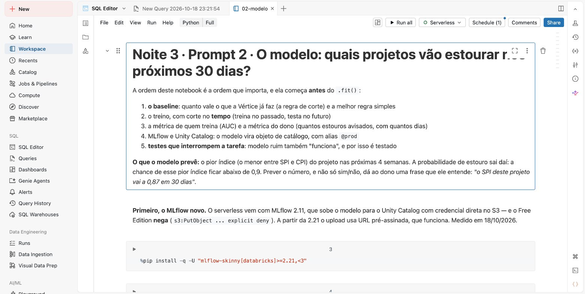
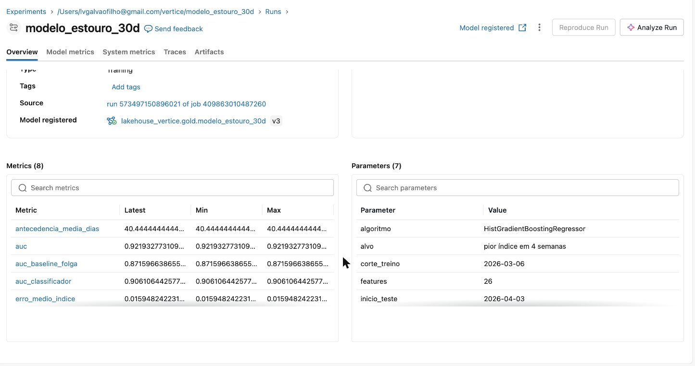
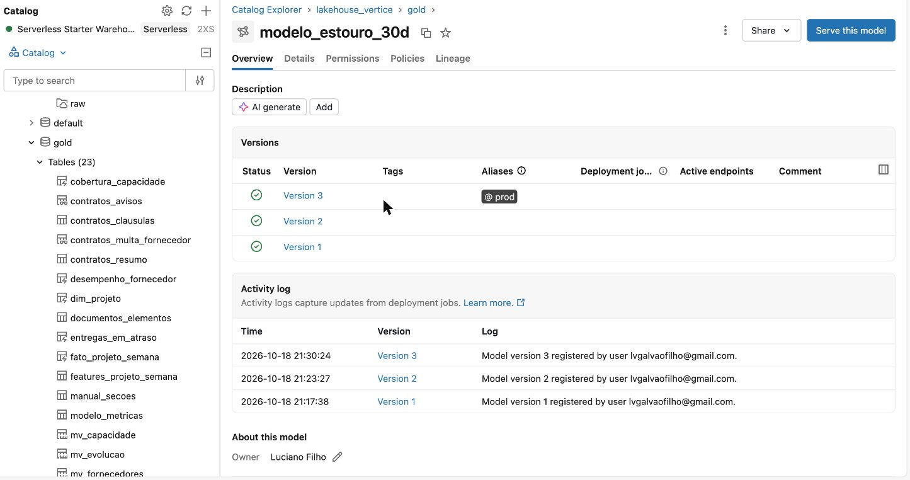

# 🔮 Noite 3: Cientista de Dados | Imersão Jornada de Dados

**Quarta, 21/10/2026, 19h30.**

**Ao fim desta noite**, toda segunda às 6h a Torre entrega ao dono uma lista dos 41 projetos em
andamento com a **chance de cada um estourar nos próximos 30 dias** e o **motivo em português**.
Hoje a Vértice só descobre o estouro depois que ele aconteceu. Com 41 dias de antecedência, dá
para pedir aditivo de horas, trocar gente de projeto ou renegociar o escopo antes de virar atraso.

É a pergunta 4 do dono:

> **"O que vai dar errado no próximo mês, e o que eu faço agora?"**

> **Formato:** 4 prompts no Claude Code. O mesmo bundle da terça: o job sai de 5 para **8 tarefas**, e no fim
> o dono pergunta em português ([`prompt-04-dashboard-e-genie.md`](prd/prompt-04-dashboard-e-genie.md): o dashboard
> "Projeto Farol · Portfólio" e o Genie "Farol · Diretoria", que até 20/10 fechavam a noite 2).
> **Onde fica cada coisa:** o laboratório do cientista (features, métricas, modelo) mora no schema
> `lakehouse_vertice.ml`; na `gold` entra só o resultado, `gold.score_estouro_30d`.
> **Conexão:** a tabela de hoje (`gold.score_estouro_30d`) é o que o app da [noite 4](../aula-04-produtos-de-dados-ia) mostra ao dono.
> **Medo de ML?** Você não vai escrever código: vai escrever o pedido, conferir números e entender
> cada decisão. Cada termo novo é explicado na primeira vez que aparece.

---

## 🎬 O caso da noite: PRJ-024, o projeto que "está ok"

Ontem a Torre passou a juntar Excel, ClickUp e MS Project sozinha e a dizer **quem já
estourou**. A regra da Vértice é simples: **SPI ou CPI abaixo de 0,9 = atenção**
(SPI mede o prazo, CPI mede o custo; 1,0 é "no plano").

Para essa regra, o **PRJ-024 · Marketplace de sellers** está ok: SPI 0,91, CPI 0,97.

No fim da noite, o modelo vai dizer outra coisa:

> **PRJ-024 · 46% de chance de cruzar 0,9 em 30 dias.** Motivo: *"a 0,01 do corte de 0,9
> (índice 0,91)"*.

O número diz "ok". O modelo diz "quase metade de chance de não estar ok daqui a um mês". E o
calendário piora a conta: é o marketplace de um cliente de varejo, um e-commerce. No freeze da
Black Friday do ano passado, o SPI dele caiu de **0,99 para 0,70**. O de 2026 começa em
**01/11**, daqui a 15 dias, e trava deploy. O modelo não sabe do calendário; o agente da
noite 4, que lê o manual, vai saber.

Guarde esse projeto: é ele que a gente persegue a noite toda.

---

## 🎯 O que você entrega

| Entrega | Onde | Prova de que funcionou |
|---|---|---|
| O rótulo e as features, sem olhar o futuro | `ml.features_projeto_semana` | 4.235 projetos×semana · taxa base **16,7%** |
| O baseline, antes do modelo | notebook `02-modelo` | a regra da folga faz AUC **0,872** |
| O modelo no Unity Catalog | `ml.modelo_estouro_30d@prod` | AUC **0,92** · ganha da regra · 4 testes passam |
| A métrica do dono | `ml.modelo_metricas` | **9 de 10** estouros avisados, **41 dias** antes |
| A lista de segunda-feira | `gold.score_estouro_30d` | 41 projetos, com probabilidade e **motivo em português** |

Os termos desta tabela (rótulo, feature, baseline, AUC, `@prod`) estão explicados logo abaixo,
na ordem em que aparecem.

---

## 📖 As palavras da noite (uma frase cada)

| Termo | Em uma frase |
|---|---|
| **Rótulo** | a resposta que queremos prever. Aqui: *"nas 4 semanas seguintes, o projeto caiu abaixo de 0,9?"* (1 = sim, 0 = não). |
| **Feature** | um sinal que o modelo olha para dar o palpite: o SPI de hoje, quanto ele caiu no mês, quantas pessoas saíram do time. |
| **Treino e teste** | o modelo aprende com uma parte do histórico (treino) e é cobrado numa parte que nunca viu (teste). |
| **Corte no tempo** | o treino é o passado (até 06/03/2026) e o teste é o futuro (de 03/04/2026 em diante), como na vida real. |
| **Vazamento** | quando uma feature, sem querer, já sabe o futuro. O modelo fica brilhante no teste e inútil na segunda-feira. |
| **Baseline** | a regra simples que já existe ou que qualquer um usaria. O modelo só entra se ganhar dela. |
| **AUC** | uma nota de 0,5 a 1: 0,5 é jogar moeda, 1,0 é acertar sempre a ordem "quem estoura antes de quem não estoura". |
| **MLflow** | o caderno de laboratório do modelo: guarda cada treino, com parâmetros, métricas e o próprio modelo. |
| **Unity Catalog e `@prod`** | o modelo vira um objeto do catálogo, como uma tabela. `@prod` é uma etiqueta que aponta para a versão em uso. |
| **Score em lote** | o modelo roda uma vez por semana, dentro do job, e grava o resultado numa tabela. Ninguém chama o modelo ao vivo. |

---

## 🧠 A ideia da noite: ML é camada, não projeto

Nada de repositório novo, notebook solto ou ambiente à parte. ML entra como
**mais três tarefas do mesmo job**, com os mesmos testes que quebram:

```
                              job vertice_farol (toda segunda às 6h)
 conferencia_bronze → medalhao ─┬→ testes_de_qualidade ─┬→ metricas_governadas
                                └→ status_com_ia ───────┘          │
                     noite 3 ──────────────────────────────────────┘
                     ml_features ──► ml_modelo ──────────► ml_score
                     (sql_task)      (notebook)             (notebook)
                     projeto×semana  baseline, treino,      a lista de hoje,
                     + rótulo        4 testes, MLflow,      com motivo
                     schema ml       schema ml (@prod)      ──► gold.score_estouro_30d ──► app (noite 4)
```

---

## 🏷️ O rótulo (a decisão mais importante da noite)

A regra de hoje acende **quando o estouro já aconteceu**. O rótulo traduz "antecipar":

```
Numa sexta-feira t, para um projeto que AINDA está "ok" (SPI e CPI >= 0,9):

  estoura_30d = 1   se o pior índice (menor entre SPI e CPI) nas 4 semanas seguintes
                    fica abaixo de 0,9
  estoura_30d = 0   senão
```

- **Uma linha por projeto e semana.** Com 60 projetos não existe ML. Com 4.235 sextas-feiras
  de projeto, existe: cada sexta é uma foto, e o rótulo é o que veio depois.
- **Só entra quem ainda está ok** (com 12+ semanas de vida e não terminado). Quem já está
  abaixo de 0,9, a regra vê; não precisa de modelo.
- **O modelo prevê o número, não só o sim/não**: o pior índice das próximas 4 semanas.
  A probabilidade sai da margem de erro dele. O dono ganha uma frase que entende:
  *"o SPI deste projeto vai a 0,87 em 30 dias"*.

---

## 🛠️ Passo a passo

**Pré-requisito:** a noite 2 rodou (`gold.fato_projeto_semana`, `gold.status_estruturado`
e `gold.projeto_situacao_atual` existem). Perdeu a noite 2? Use o gabarito como checkpoint:
`cd aulas/aula-03-modelagem-claude-code/claude-code/vertice && databricks bundle deploy --profile SEU-PERFIL &&
databricks bundle run vertice_farol --profile SEU-PERFIL` (~5 min, já inclui as tarefas da noite 3).

Abra o Claude Code na raiz do repositório (`claude`). Cada prompt mora num arquivo com o texto
para copiar, o que mostrar antes, o que conferir e a tabela **"se der errado"**. A sequência
inteira das noites 2 a 4 está em [`PROMPTS.md`](../../PROMPTS.md).

### Passo 1 · Features: o que descreve um projeto que vai estourar

Cole o [prompt 1](prd/prompt-01-features.md). Ele cria o schema `ml` e a tabela
`ml.features_projeto_semana`: uma linha por projeto e semana com **24 sinais que só olham para trás**:

- **nível**: SPI, CPI e o menor dos dois;
- **tendência**: quanto caíram em 4 e 8 semanas;
- **ritmo do último mês**: `cpi_ultimas_4s`, quanto cada R$ gasto no mês entregou;
- **gente e custo**: ociosidade, saídas do time (quem apontou hora no projeto e se desligou),
  peso da consultoria e da cloud no custo do mês;
- **o texto do status semanal**, que a IA classificou na noite 2 (freeze, falta de SRE,
  consultoria, rotatividade, escopo). A noite 2 vira matéria-prima da noite 3.

Mais os dois alvos do futuro (`alvo_pior_indice_30d` e `estoura_30d`), que **nunca** entram como feature.

**Confira:** 4.235 linhas, 1.643 linhas elegíveis com rótulo, taxa base 0,167. Em português: de cada
100 semanas de projeto "ok", 17 terminam o mês abaixo de 0,9. Achar essas 17 antes é o trabalho do modelo.

### Passo 2 · O modelo: primeiro o baseline, depois o treino

Cole o [prompt 2](prd/prompt-02-modelo.md). Ele cria o notebook `src/ml/02-modelo.py` e a tarefa `ml_modelo`.


*O notebook `02-modelo` gerado pelo prompt. Repare na ordem escrita no topo: o baseline vem
**antes** do treino, e os testes vêm antes de registrar. A primeira célula de código é o `%pip`
que atualiza o MLflow (sem ela, o registro falha no Free Edition).*

**O momento da noite.** Antes de treinar, pergunte para a sala que regra simples ela usaria.
Depois mostre o que cada regra vale no teste (580 semanas de projeto a partir de 03/04/2026,
70 delas terminaram o mês abaixo de 0,9):

| Regra | AUC |
|---|---|
| a regra de corte atual (< 0,9) | 0,50 — não avisa nada antes |
| a tendência das últimas 4 semanas | **0,48** — pior que jogar uma moeda |
| só o CPI | 0,65 |
| **a folga até o corte** (quem está mais perto de 0,9) | **0,872** |
| o classificador sim/não (HistGradientBoostingClassifier) | 0,90 |
| **o modelo que prevê o índice** (HistGradientBoostingRegressor) | **0,92** |

**A lição:** a regra de bolso é boa. O modelo só entra porque **ganha** dela. E isso é um teste
(`assert`) que quebra a tarefa se um dia deixar de ser verdade. Os 4 testes, antes de registrar:
AUC ≥ 0,75; AUC < 0,98 (acima disso é vazamento); AUC ≥ a folga até o corte; pelo menos 70% dos
estouros avisados.

**Por que corte no tempo?** Com divisão aleatória, a semana 20 de um projeto vai para o treino e a
semana 21 para o teste: o modelo "cola" e você não tem como saber. O notebook de conferência
[`02-o-vazamento-de-dado.py`](notebooks/02-o-vazamento-de-dado.py) mostra os três jeitos lado a lado.

Depois dos testes, o modelo é registrado no MLflow e no Unity Catalog:


*A execução no MLflow. Repare em: `auc` 0,9219, `auc_baseline_folga` 0,8716 e `auc_classificador`
0,9061 (as três réguas da tabela acima), `antecedencia_media_dias` 40,4, e nos parâmetros: corte do
treino em 2026-03-06, início do teste em 2026-04-03, 26 features. No topo, o link "Model registered":
o treino virou modelo do catálogo. (Print de 18/10, antes da simplificação: hoje são 24 features e
41 dias de antecedência.)*


*O modelo no Catalog Explorer. Repare na etiqueta `@prod` na versão mais nova: é ela que o score
carrega. Cada execução do job cria uma versão; a etiqueta muda de lugar, o nome que o score usa não
muda. (Print de 18/10, quando o modelo ainda morava na gold; hoje é `lakehouse_vertice.ml.modelo_estouro_30d`,
ao lado das features e das métricas.)*

**Confira** em `ml.modelo_metricas`: AUC 0,92, **9 de 10** estouros avisados, 41 dias antes.

### Passo 3 · O score: a lista de segunda-feira, com motivo

Cole o [prompt 3](prd/prompt-03-score.md). Ele cria o notebook `src/ml/03-score.py` e a tarefa
`ml_score`, e roda o job inteiro.

O Free Edition não tem endpoint de modelo próprio, então o modelo roda **em lote**: toda segunda,
dentro do job, e o resultado vira a tabela `gold.score_estouro_30d`. Quem já está abaixo de 0,9 hoje
recebe 1,0 (a regra já acendeu; o modelo só explica por quê).


*O job `vertice_farol`, todas as tarefas verdes. Repare nas três da direita, `ml_features →
ml_modelo → ml_score`: são as de hoje, penduradas depois das métricas da noite 2. ML é mais uma camada.
(Print de 18/10, com 9 tarefas; hoje são 8: a tarefa de postmortem saiu.)*


*O topo de `gold.score_estouro_30d` no SQL Editor. Repare que as 15 primeiras linhas têm
probabilidade 1 e começam com "já abaixo do corte": são projetos que a regra já vê. Na coluna de
motivos, sinais em português e com números (ritmo do mês, CPI caindo, falta de SRE, saídas do time).
O valor novo do modelo aparece logo abaixo do ranking 17.*

A lista completa, com o caso da noite:

| # | Projeto | Prob. | Faixa | Motivos |
|---|---|---|---|---|
| 1 | PRJ-016 · Integração com laboratórios | 1,00 | alto | já abaixo do corte: SPI 0,63; ritmo do último mês em 56% do planejado; … |
| 5 | PRJ-011 · Checkout e meios de pagamento | 1,00 | alto | já abaixo do corte: SPI 0,77; falta de SRE em 4 dos últimos 4 status; … |
| 6 | PRJ-027 · Migração do mainframe | 1,00 | alto | já abaixo do corte: CPI 0,79; CPI caindo há 3 de 4 semanas (−0,009); cada R$ 1 gasto no último mês entregou R$ 0,67 |
| … | | | | (17 projetos que a regra já vê) |
| 18 | PRJ-013 · Gestão de estoque em tempo real | 0,89 | alto | pelo status semanal o índice já é 0,90: o cronograma da ferramenta diz 0,94 |
| **19** | **PRJ-024 · Marketplace de sellers** | **0,46** | **medio** | **a 0,01 do corte de 0,9 (índice 0,91)** |
| … | | | | (mais 3 projetos "ok" na faixa média; o resto, baixo) |

**O momento "uau":** é aqui que o PRJ-024 aparece. Ok para a regra, 46% para o modelo, com o
motivo escrito. E é um e-commerce a 15 dias do change freeze da Black Friday (01/11), que trava
deploy: o número diz "ok", o modelo e o calendário dizem "olhe agora".

**E a lição de qualidade do PRJ-013:** 89% de chance com SPI 0,94 na planilha. O status de sexta
diz 43% concluído; a planilha soma 45%, porque uma tarefa foi digitada com mais de 100% e a silver
cortou em 100. O modelo aprendeu com o status, e o motivo avisa que as duas fontes não batem.
**Qualidade de dado é feature.**

### Passo 4 · Verificação

```bash
python3 scripts/run_sql.py aulas/aula-03-modelagem-claude-code/99-verificacao.sql --profile SEU-PERFIL
# 17 linhas "ok"
```

Depois abra os notebooks de conferência ([`notebooks/`](notebooks)): o que o modelo vale e a
demonstração de vazamento.

---

## 💼 A frase para o dono (a métrica que não é AUC)

> *"Dos 10 projetos que estouraram depois de abril, a Torre teria colocado **9** na
> lista dos 5 mais arriscados da semana, em média **41 dias antes**. A regra de
> corte que usamos hoje avisou **zero** antes."*

Quarenta e um dias é tempo de pedir aditivo de horas (leva 30), trocar gente de projeto
ou renegociar o escopo com o cliente antes de virar atraso.

---

## 🔢 O que deve aparecer na tela

| Métrica | Valor |
|---|---|
| `ml.features_projeto_semana` · linhas de treino · taxa base | 4.235 · 1.643 · 16,7% |
| Teste (a partir de 03/04/2026) | 580 projetos×semana, 70 terminaram o mês abaixo de 0,9 |
| AUC: regra da folga · classificador · **modelo** | 0,87 · 0,90 · **0,92** |
| Erro médio do índice previsto · sigma (ensaio de 18/10) | 0,016 · 0,021 |
| Estouros avisados no top 5 · antecedência | **9 de 10** · **41 dias** |
| Estouro previsto hoje dos projetos avisados (ensaio de 18/10) | R$ 2,44 mi |
| Feature mais importante (permutação) | `pct_fisico` |
| Score: alto · medio · baixo | 18 · 4 · 19 |
| Todo projeto crítico ou em atenção com prob 1,0 | 17 |
| Projetos "ok" para a regra com risco alto ou médio | 5 (entre eles PRJ-013, 0,89, e PRJ-024) |
| O "uau" | **PRJ-024**, 46%: e-commerce a 0,01 do corte, e o freeze começa em 01/11 |
| Vazamento: corte no tempo · aleatório · com índice do futuro | 0,922 · 0,917 · **0,991** (barrado pelo teste de 0,98)¹ |

Números remedidos em 19/10, depois da simplificação (schema `ml`, 24 features).
¹ O notebook do vazamento é de 18/10 (26 features) e não foi remedido: a 2ª casa pode variar.

Tudo com `random_state=42` e seed 42: rodando de novo, dá igual (medido: três execuções
do job completo em 18/10 gravaram as mesmas métricas).

**Tempos medidos (18/10):** features ~20 s · modelo ~1 min · score ~45 s · job completo
**4 a 5 min** (na época com 9 tarefas; hoje são 8).

---

## 🧯 Se der errado

| Sintoma | Causa | O que fazer |
|---|---|---|
| `s3:PutObject ... explicit deny` ao registrar o modelo | o serverless vem com MLflow 2.11 | `%pip install -U "mlflow-skinny[databricks]>=2.21,<3"` + `restartPython()` na 1ª célula |
| `PARSE_SYNTAX_ERROR ... missing ')'` no SQL das features | janela nomeada com frame (`OVER (w ROWS ...)`) | escreva a janela por extenso |
| `metricas_governadas` falha no job, mas roda no `run_sql.py` | `;` dentro do YAML de uma metric view | a `sql_task` corta em todo `;`: tire o `;` do comentário |
| `SyntaxError` numa frase em português | célula de texto sem `# MAGIC %md` | toda célula de markdown começa com `# MAGIC %md` |
| `BAD_REQUEST: For input string: "None"` | `set_experiment` numa pasta que não existe | `WorkspaceClient().workspace.mkdirs(...)` antes |
| `Object of type Decimal is not JSON serializable` | coluna DECIMAL no `input_example` | `.astype(float)` |
| `InvalidVersion: '18.x-aarch64-photon-scala2'` | `mlflow.pyfunc.spark_udf` no serverless | `mlflow.sklearn.load_model` + pandas |
| `AssertionError: perde da regra simples` | features erradas, ou o dado mudou | é o teste fazendo o trabalho dele: confira o prompt 1 |
| `AssertionError: bom DEMAIS` | feature que vê o futuro | procure `FOLLOWING` fora das colunas `alvo_`/`estoura_` |
| `Function ... is not empty` ao apagar o modelo | versão órfã de um registro que falhou | o `99-limpar` apaga as versões antes |

### Ensaiar de novo, do zero

```bash
bash aulas/aula-03-modelagem-claude-code/prd/99-limpar-aula-03.sh SEU-PERFIL            # simula
bash aulas/aula-03-modelagem-claude-code/prd/99-limpar-aula-03.sh SEU-PERFIL --apagar   # apaga tabelas, modelo,
                                                                           # experimento e o src/ml do meu-vertice
# instrutor, com o gabarito: acrescente --gabarito para limpar só o workspace
```

---

## 🗂️ Arquivos desta pasta

| Arquivo | Para que serve |
|---|---|
| `prd/prompt-01-features.md` · `prompt-02-modelo.md` · `prompt-03-score.md` · `prompt-04-dashboard-e-genie.md` | os 4 prompts, com roteiro e "se der errado" |
| `prd/99-limpar-aula-03.sh` | apaga só a noite 3 (tabelas e modelo do schema `ml`, o score da gold, experimento, `src/ml` do meu-vertice) |
| `99-verificacao.sql` | 17 checagens esperado × obtido |
| `notebooks/01-o-que-o-modelo-vale.sql` | conferência: métricas, lista de segunda e a curva do PRJ-024 |
| `notebooks/02-o-vazamento-de-dado.py` | o mesmo modelo em 3 divisões: honesta, aleatória e com vazamento |
| `APRENDIZADOS.md` | o que falhou no Free Edition e como resolvemos |
| Gabarito | [`../aula-03-modelagem-claude-code/claude-code/vertice/src/ml/`](../aula-03-modelagem-claude-code/claude-code/vertice/src/ml) + as tarefas `ml_*` em `resources/vertice.job.yml` |

---

## ➡️ Amanhã

A lista existe, com motivo. Mas ela mora numa tabela, e o dono não abre o
SQL Editor. Amanhã ela ganha uma **URL**: o app da Torre, onde o dono vê a
lista, simula realocar um dos SREs parados no PRJ-007 para o PRJ-011 e
**aprova**, com a decisão gravada no Lakebase. E um agente que lê os contratos
de fornecedor e o manual da Vértice e diz o que fazer antes do freeze. → [aula-04](../aula-04-produtos-de-dados-ia)
