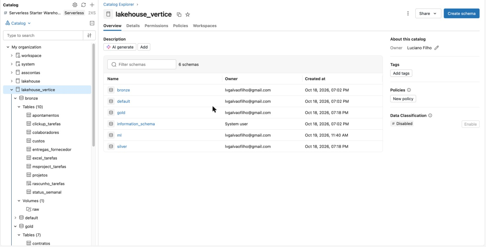
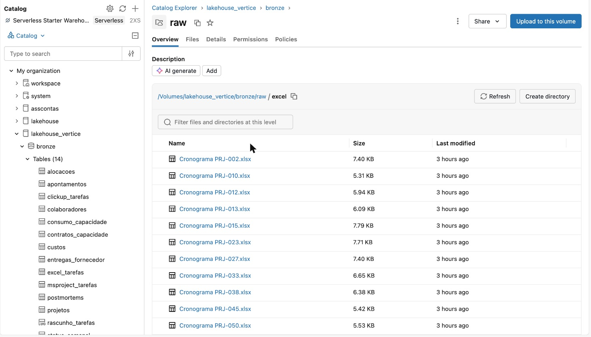
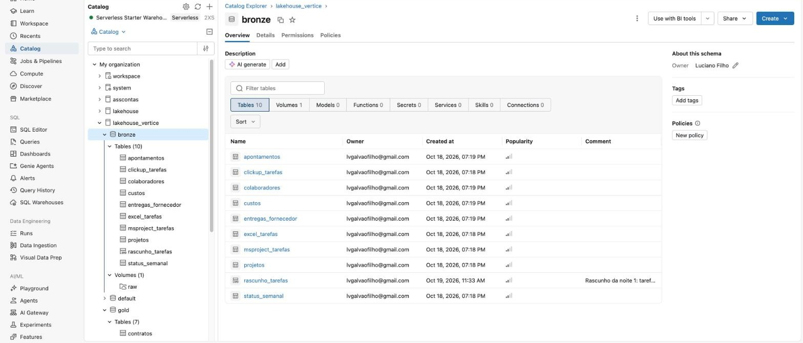
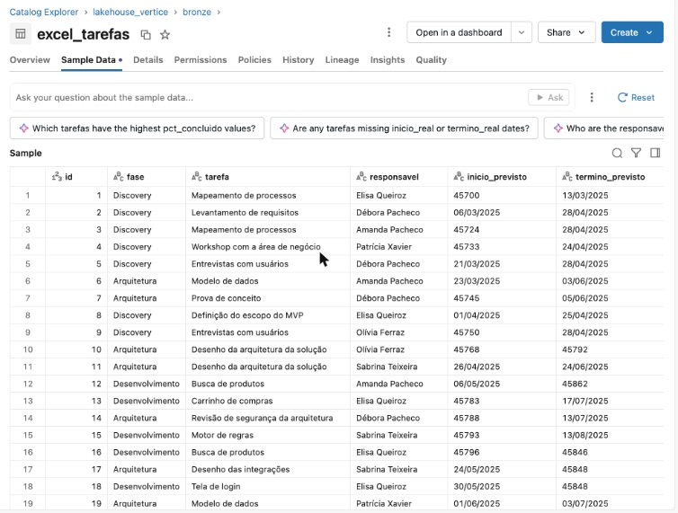
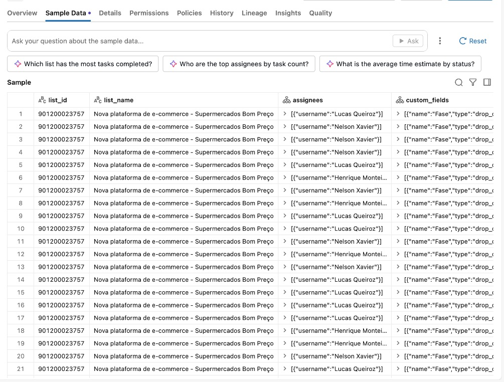
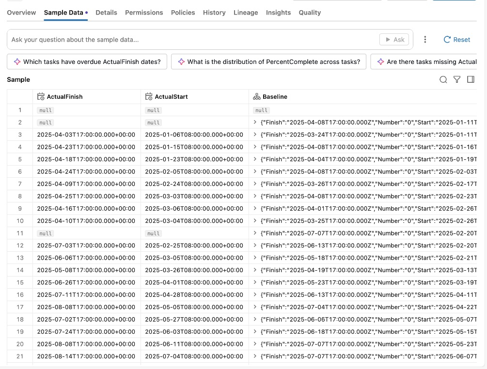
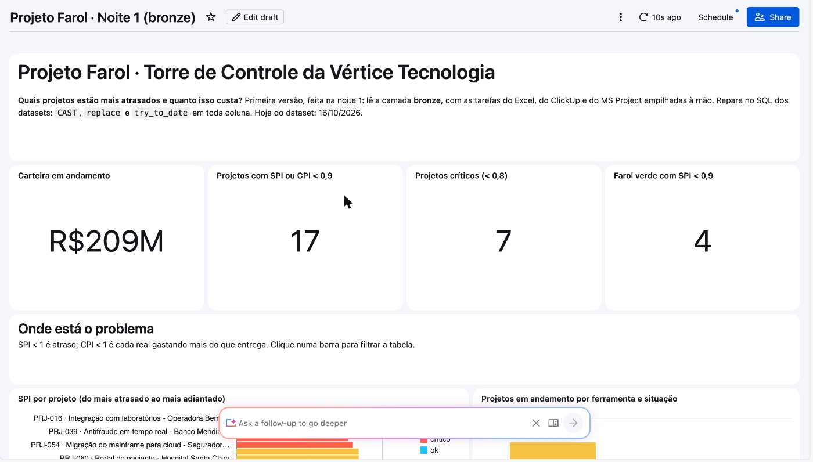
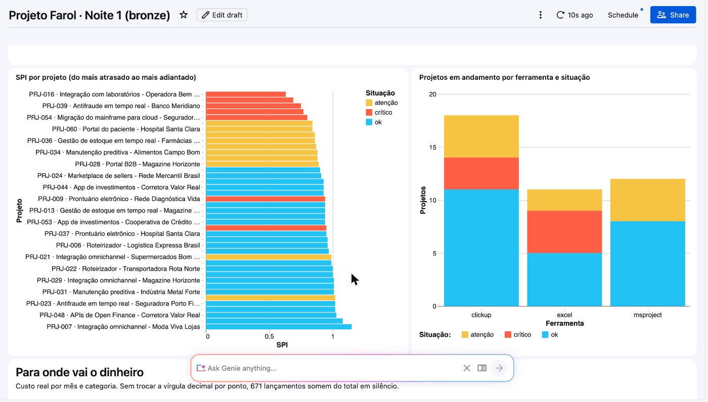
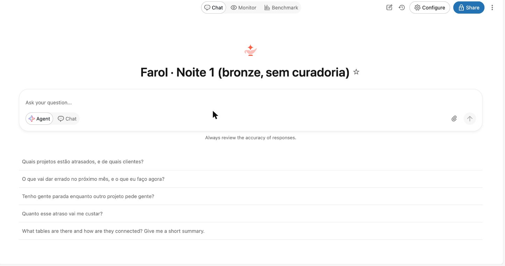
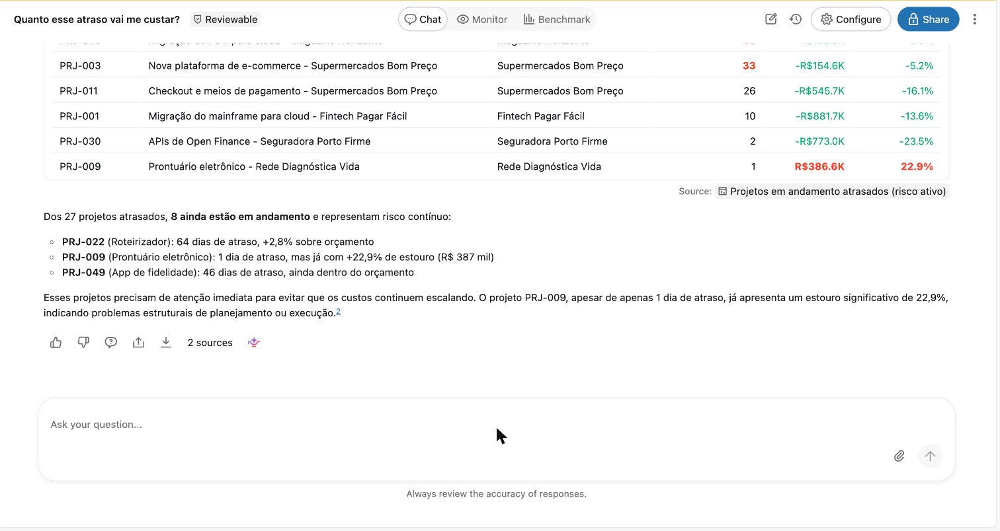

# 📊 Noite 1 · Analista | Imersão Databricks + Claude Code

> **Segunda, 19/10, 19h30** · 📺 gravação: _link após a live_

**Ao fim desta noite você vai:** ler as planilhas Excel, os exports do ClickUp e os cronogramas do MS Project
da Vértice dentro do Databricks, sem converter nada; responder qual projeto está mais atrasado e quanto isso
vai custar (R$ 6,47 mi); e mostrar a resposta num dashboard publicado. Tudo pelo navegador, sem instalar nada.

---

## 🏢 O caso: a Vértice Tecnologia

Você é o **único profissional de dados da Vértice Tecnologia**: 520 pessoas, 60 projetos de clientes (varejo,
financeiro, saúde, logística e indústria). Sem time de dados, você vai ser o analista hoje, o engenheiro amanhã,
o cientista na quarta e o engenheiro de IA na quinta.

Na primeira semana, o dono te chama e faz quatro perguntas:

1. **Quais projetos estão atrasados, e de quais clientes?**
2. **Quanto esse atraso vai me custar?**
3. **Tenho gente parada enquanto outro projeto pede gente?**
4. **O que vai dar errado no próximo mês?**

Ninguém sabe responder. Cada gerente controla o projeto num lugar diferente:
**20 projetos em planilhas Excel, 25 no ClickUp e 15 no MS Project**. Nada está junto.

**Hoje você ataca as perguntas 1 e 2.** As outras duas ficam para as noites 2 e 3.

> **Conexão com amanhã:** o que você junta à mão hoje é o que a [noite 2](../aula-02-engenheiro) transforma
> num pipeline. E o Genie que erra hoje é o mesmo que a noite 2 conserta.

---

## 🎯 Objetivos da noite

| # | Objetivo | Como você sabe que chegou lá |
|---|---|---|
| 1 | Montar o ambiente no Databricks Free Edition | catálogo `lakehouse_vertice` com `bronze`, `silver`, `gold` e o volume `raw` |
| 2 | Ler Excel, JSON e XML com o mesmo comando | 9 tabelas na bronze, contagens iguais às do `99-verificacao.sql` |
| 3 | Encontrar a sujeira antes que ela vire decisão | os 3 achados do exemplo 03 |
| 4 | Juntar as três ferramentas e responder o dono | SPI dos 41 projetos em andamento (exemplo 05) |
| 5 | Traduzir o atraso em dinheiro, e desconfiar do farol | R$ 6,47 mi de estouro previsto e 4 projetos "melancia" (exemplo 06) |
| 6 | Colocar a resposta numa tela e ver o Genie errar | dashboard publicado + as 4 perguntas do dono no Genie da bronze |

---

## 📖 As palavras da noite

Você vai ouvir estes termos o tempo todo. Uma frase para cada:

| Termo | O que é, em uma frase |
|---|---|
| **Serverless** | o Databricks liga o computador por você; você não cria nem desliga nada |
| **Unity Catalog** | o "arquivo de pastas" do Databricks: catálogo > schema > tabela, com controle de quem vê o quê |
| **Catálogo** | a gaveta de cima; o nosso se chama `lakehouse_vertice` |
| **Schema** | uma pasta dentro do catálogo; usamos três: `bronze`, `silver` e `gold` |
| **Bronze · silver · gold** | as três camadas do dado: cru como chegou · limpo e junto · pronto para a diretoria (o "medalhão") |
| **Volume** | um lugar para guardar **arquivos** (planilhas, JSON, XML, PDF) dentro do catálogo |
| **Tabela Delta** | a tabela do Databricks: o arquivo virou linhas e colunas que o SQL consegue ler |
| **SPI** | índice de prazo: quanto o projeto entregou ÷ quanto devia ter entregado até hoje. **Abaixo de 1 é atraso** |
| **CPI** | índice de custo: quanto o trabalho entregue vale ÷ quanto já se gastou. **Abaixo de 1 é estouro** |
| **Farol** | a cor (verde, amarelo, vermelho) que o gerente põe no status de toda sexta |
| **Melancia** | projeto verde por fora (farol do gerente) e vermelho por dentro (o número) |
| **Dashboard** | uma tela com números e gráficos, publicada para a diretoria |
| **Genie** | um assistente que responde perguntas em português escrevendo SQL sozinho |

O "hoje" do dataset é **16/10/2026**. Todas as contas usam essa data, nunca a data do seu relógio.

---

## 🛠️ Passo a passo

### 1. Crie a conta (5 min)

Entre em [databricks.com/learn/free-edition](https://www.databricks.com/learn/free-edition). Não pede cartão.
Tudo roda em **serverless**: você não precisa criar cluster.

### 2. Monte a casa do dado: catálogo, camadas e volume (5 min)

Tudo pelo menu da esquerda, sem código. É aqui que a gente desenha a estratégia: **um catálogo** para o projeto e
**três camadas** (o medalhão) antes de qualquer dado chegar.

1. **Catalog → `+` (ao lado de "Catalog") → Create a catalog**. Nome: `lakehouse_vertice`. Tipo: **Standard**,
   storage padrão. **Create**.
2. Dentro de `lakehouse_vertice`: **Create schema** três vezes: `bronze`, `silver` e `gold`.
   - `bronze`: o dado como veio de cada ferramenta, sujeira inclusa (hoje);
   - `silver`: limpo e integrado, as 3 ferramentas num modelo só (noite 2);
   - `gold`: pronto para a diretoria (noite 2).
3. Dentro de `bronze`: **Create → Volume**. Nome: `raw`. Tipo: **Managed**. É uma pasta para guardar **arquivos**
   (planilha, JSON, XML, CSV) dentro do catálogo.

> **O botão "Create a catalog" deu erro?** Abra o **SQL Editor** e rode
> [`00-setup-catalogo.sql`](00-setup-catalogo.sql): ele cria o catálogo, os 3 schemas e o volume de uma vez.

### 3. Baixe os arquivos da Vértice e suba no volume (5 min)

1. Baixe o **`dados-vertice.zip`** da pasta da imersão no Drive (link no chat da aula) e descompacte. Saem 9 pastas.
2. Abra **Catalog → lakehouse_vertice → bronze → Volumes → raw**.
3. Para cada pasta, **Create directory** com o mesmo nome e, dentro dela, **Upload to this volume** com os arquivos
   (dá para selecionar todos de uma vez):

| Pasta no volume | O que vai dentro |
|---|---|
| `pmo/` | `projetos.csv` · `status_semanal.csv` |
| `excel/` | as 20 planilhas `.xlsx` |
| `clickup/` | os 25 `.json` |
| `msproject/` | os 15 `.xml` |
| `rh/` | `colaboradores.csv` |
| `timesheet/` | `apontamentos.csv` |
| `financeiro/` | `custos.csv` |
| `compras/` | `entregas_fornecedor.csv` |

A pasta `documentos/` (os contratos em PDF) é usada na noite 4 e no bônus do exemplo 07: se for rodar o bônus, suba ela também.

> **O caminho importa.** O SQL do passo 4 procura `/Volumes/lakehouse_vertice/bronze/raw/pmo/projetos.csv`, e assim
> por diante. Arquivo fora da pasta certa vira tabela com 0 linhas.

Abra **Catalog** no menu da esquerda e clique em `lakehouse_vertice`:



*Repare nos três schemas que você criou à mão: `bronze`, `silver` e `gold`. O `default` e o `information_schema` o
Databricks cria sozinho. Hoje só a `bronze` recebe dado; `silver` e `gold` ficam vazias até a noite 2.*

Agora entre em **bronze → Volumes → raw → excel**:



*Repare: são arquivos `.xlsx` de verdade, um por projeto (`Cronograma PRJ-002.xlsx`…), guardados no volume. Ainda
não é tabela. É exatamente o que cada gerente mandaria por e-mail.*

### 4. Transforme os arquivos em tabelas: a bronze (2 min)

Abra o [`01-ingestao-bronze.sql`](01-ingestao-bronze.sql) aqui no GitHub, copie tudo, cole numa query nova do
**SQL Editor** e rode (**Run all**).
O mesmo comando (`read_files`) lê CSV, Excel, JSON e XML. A última query mostra as 9 tabelas e as linhas de cada uma.



*Repare na lista de tabelas: `excel_tarefas`, `clickup_tarefas`, `msproject_tarefas` e as outras. No print aparecem
10 porque ele foi tirado depois do exemplo 05, que cria a view `rascunho_tarefas`. Logo depois do passo 4 você vê 9.*

### 5. Olhe o dado antes de fazer conta

Clique numa tabela e abra a aba **Sample Data**. Veja como cada ferramenta chegou:



*Excel: na mesma coluna de data aparece `13/03/2025` e `45700`. O `45700` é uma data guardada como número de série
do Excel. Cada gerente preencheu do seu jeito.*



*ClickUp: `assignees` e `custom_fields` são listas dentro de uma célula (o JSON da API). O % concluído está escondido
lá dentro, no meio dos campos personalizados.*



*MS Project: datas completas com fuso (`2025-04-03T17:00:00…`) e a `Baseline` (o plano original) como uma
estrutura aninhada.*

Três ferramentas, três formatos, três jeitos de dizer "quanto está pronto". É isso que os exemplos vão juntar.

### 6. Volte no tempo (bônus, 3 min)

Rode o [`exemplo-00-time-travel.sql`](exemplo-00-time-travel.sql) bloco a bloco. Ele copia o cadastro de projetos,
duplica o PRJ-021 de propósito (a carteira vai de R$ 305,2 mi para R$ 318,8 mi), mostra o `DESCRIBE HISTORY`, lê a
versão de antes do erro com `VERSION AS OF 0` e volta com `RESTORE`. Toda tabela Delta guarda as versões: um erro na
bronze não é o fim do mundo. No fim ele apaga a cópia.

### 6.1 Rode os 6 exemplos (21 queries, ~1 hora)

Abra o [`exemplo-01-a-05-sql-na-bronze.sql`](exemplo-01-a-05-sql-na-bronze.sql) (exemplos 01 a 05) e depois o
[`exemplo-06-quanto-custa-o-atraso.sql`](exemplo-06-quanto-custa-o-atraso.sql). Rode no SQL Editor, na ordem,
**um bloco de cada vez** (selecione e Ctrl+Enter).
Cada bloco diz no comentário o que queremos achar, o que cada comando faz e o que deve aparecer.
Detalhes na seção [Os 6 exemplos](#-os-6-exemplos).

### 7. Confira (1 min)

Com o exemplo 05 já rodado (ele cria o rascunho que a verificação usa), rode [`99-verificacao.sql`](99-verificacao.sql).
As 18 linhas devem dar `ok`. Se alguma der `CONFIRA`, veja [Se der errado](#-se-der-errado).

### 8. Monte e publique o dashboard (15 min)

Pela interface, em 4 passos: **Dashboards → Create dashboard** → aba **Data**, cole os 2 SQLs prontos
([`dashboard-dataset-projetos.sql`](dashboard-dataset-projetos.sql) e
[`dashboard-dataset-custos.sql`](dashboard-dataset-custos.sql)) → no canvas, **Add a visualization** e digite o
prompt de cada gráfico → **Publish**. Os 8 prompts e o "à mão" de cada gráfico estão em
[**passo-a-passo-dashboard-e-genie.md**](passo-a-passo-dashboard-e-genie.md).



*Repare nos 4 números do topo: carteira em andamento (o R$ 209M é o R$ 208,6 mi arredondado), 17 projetos com SPI
ou CPI abaixo de 0,9, 7 críticos e 4 com farol verde e SPI abaixo de 0,9. São os mesmos números dos exemplos 05 e
06: o dashboard não inventa nada, ele roda o mesmo SQL.*



*À esquerda, o SPI de cada projeto, do mais atrasado (PRJ-016) ao mais adiantado; vermelho é crítico, amarelo é
atenção. À direita, os projetos em andamento separados por ferramenta (ClickUp, Excel, MS Project). Pela primeira
vez alguém vê as três ferramentas lado a lado. Clique numa barra: a tabela embaixo filtra.*

### 9. Faça as 4 perguntas ao Genie (8 min)

**Genie Agents → + New** → marque as 8 tabelas da bronze (`projetos`, `status_semanal`, `excel_tarefas`,
`clickup_tarefas`, `msproject_tarefas`, `colaboradores`, `apontamentos`, `custos`) → **Create** → renomeie para
**Farol · Noite 1 (bronze, sem curadoria)**. Ele **não recebe nenhuma instrução**. De propósito. As perguntas para
copiar e colar estão em [passo-a-passo-dashboard-e-genie.md](passo-a-passo-dashboard-e-genie.md#parte-2--o-genie-farol--noite-1-bronze-sem-curadoria-10-min).



*Repare nas perguntas sugeridas: são as 4 do dono. Clique em cada uma, na ordem.*



*Repare: a resposta vem bonita, em tabela, com fonte. E está errada. Ele inventou a própria regra de "atrasado"
(fala em 27 projetos atrasados e em PRJ-009 com "1 dia de atraso") e não chega aos R$ 6,47 mi de estouro do
exemplo 06. Ninguém disse a ele o que é SPI, CPI ou estouro na Vértice.*

O roteiro completo, com o que o Genie fez em cada pergunta no ensaio, está em
[`roteiro-genie-e-dashboard.md`](roteiro-genie-e-dashboard.md).

> **A lição:** o Genie é tão bom quanto o dado e as definições que você dá a ele. Hoje o dado está em três
> ferramentas e cada KPI mora dentro de uma query. Amanhã isso muda.

---

## 🗄️ O dado: o que tem no volume

**60 projetos** (41 em andamento) · **R$ 305,2 mi** de carteira (R$ 208,6 mi em andamento) · **520 pessoas**.

```
Volume /Volumes/lakehouse_vertice/bronze/raw
├── pmo/          projetos · status_semanal        (cadastro do PMO e o status de toda sexta, em texto livre)
├── excel/        20 planilhas .xlsx               (uma por projeto, cada gerente do seu jeito)
├── clickup/      25 exports .json da API          (uma lista por projeto, tarefas dentro)
├── msproject/    15 arquivos .xml                 (uma <Task> por tarefa, com fases e baseline)
├── rh/           colaboradores                    (as 520 pessoas: papel, custo/hora, admissão, saída)
├── timesheet/    apontamentos                     (horas disponíveis × apontadas, por pessoa e semana)
├── financeiro/   custos
├── compras/      entregas_fornecedor              (o que cada consultoria prometeu × entregou)
└── documentos/   contratos/*.pdf (8) · manual/manual_de_tecnologias.pdf
```

| Tabela | Linhas | O que é | ⚠️ Cuidado |
|---|---:|---|---|
| `projetos` | 60 | cadastro do PMO: cliente, valor, prazo e **em qual ferramenta** o projeto vive | `data_inicio` em 2 formatos; ferramenta escrita de 8 jeitos; 2 projetos sem código |
| `status_semanal` | 3.911 | avanço, farol e bloqueios de cada sexta | farol do gerente é otimista; textos vazios |
| `excel_tarefas` | 1.663 | as 20 planilhas | data em texto **ou** número de série; % como "45%" ou 0.45; linha de TOTAL; % > 100 |
| `clickup_tarefas` | 2.119 | as 25 listas do ClickUp | datas em milissegundos; status escrito de 12 jeitos; % dentro de uma lista de campos |
| `msproject_tarefas` | 1.260 | os 15 cronogramas do Project | horas em `PT40H0M0S`; 105 tarefas-resumo que somam as de baixo |
| `colaboradores` | 523 | as 520 pessoas | 3 pessoas duplicadas |
| `apontamentos` | 30.883 | horas disponíveis × apontadas por semana | hora extra (> 100%) é legítima |
| `custos` | 23.640 | lançamentos de custo real | 671 com vírgula decimal; estornos negativos |
| `entregas_fornecedor` | 640 | entregas das consultorias: prometido × entregue | a CodeForge escrita de 4 jeitos |

> **Por que CSV e Excel entram como texto?** Se o Databricks adivinhasse os tipos, `14/03/2025` virava nulo,
> `12345,67` virava erro e o número de série do Excel virava um número qualquer. A bronze guarda o problema
> para que ele seja resolvido, não escondido. JSON e XML entram com a estrutura adivinhada: é ela que diz o que
> está dentro de quê.

### As 5 histórias que o dado esconde

1. **8 projetos com CPI caindo a partir do 6º mês**: o cliente pede mais, o time faz, ninguém cobra o aditivo.
2. **O change freeze da Black Friday** (01/11 a 10/01, período em que ninguém mexe em produção) trava os 3 projetos
   de e-commerce (PRJ-003, PRJ-011, PRJ-024).
3. **A consultoria CodeForge** entrega com prazo **41% acima** do prometido, e aparece escrita de 4 jeitos.
4. **Dois SREs seniores ociosos no PRJ-007**, que ainda está no desenho, enquanto o status do PRJ-011 pede SRE toda semana.
5. **Dois squads com rotatividade alta** (PRJ-016 e PRJ-030): os dois piores SPI da carteira.

Hoje você vê os sintomas: atraso, estouro e o farol que não bate. As causas aparecem nas noites 2 e 4.

---

## 🧪 Os 6 exemplos

São **21 queries** no total, para caber em 1 hora de SQL. Os exemplos 01 a 05 estão num arquivo só,
[`exemplo-01-a-05-sql-na-bronze.sql`](exemplo-01-a-05-sql-na-bronze.sql), uma seção por exemplo; o 06 fica à parte. Cada exemplo usa o anterior, e cada bloco traz no máximo
um ou dois comandos novos, explicados no comentário. Rode no SQL Editor ou use os notebooks (logo abaixo).

| # | Arquivo | Queries | Conceito | Pergunta de negócio |
|---|---|---:|---|---|
| 01 | [`exemplo-01-a-05-sql-na-bronze.sql`](exemplo-01-a-05-sql-na-bronze.sql) | 2 | `SELECT`, `LIMIT`, `COUNT` | Que projetos a Vértice tem, e onde cada um vive? |
| 02 | [`exemplo-01-a-05-sql-na-bronze.sql`](exemplo-01-a-05-sql-na-bronze.sql) | 3 | `ORDER BY`, `CAST`, `DISTINCT` | Quais os maiores contratos? |
| 03 | [`exemplo-01-a-05-sql-na-bronze.sql`](exemplo-01-a-05-sql-na-bronze.sql) | 7 | `WHERE`, `LIKE`, `AND`, `IN`, `IS NULL` | **Dá para confiar nesse número?** |
| 04 | [`exemplo-01-a-05-sql-na-bronze.sql`](exemplo-01-a-05-sql-na-bronze.sql) | 2 | `GROUP BY`, `SUM`, `replace` | Para onde vai o dinheiro? (a 1ª query **quebra de propósito**) |
| 05 | [`exemplo-01-a-05-sql-na-bronze.sql`](exemplo-01-a-05-sql-na-bronze.sql) | 5 | `UNION ALL`, `VIEW`, `CASE`, `JOIN`, `WITH` | **Quais projetos estão mais atrasados?** (as 3 ferramentas numa fila só) |
| 06 | [`exemplo-06-quanto-custa-o-atraso.sql`](exemplo-06-quanto-custa-o-atraso.sql) | 2 | `WITH`, conta de KPI | **Quanto o atraso custa? O farol mostra isso?** |

O que esperar de cada um:

- **01 e 02:** o primeiro contato. No 02, ordenar valor guardado como texto dá a ordem errada; o `CAST` conserta.
- **03:** dado sujo não dá erro: dá um número errado, em silêncio. 3 achados (data em 2 formatos, a linha de TOTAL
  nas 20 planilhas, 671 custos com vírgula) e 4 jeitos de filtrar: `AND` (14 projetos de varejo em andamento), `IN`
  (os 20 do Excel, escritos de 3 jeitos), `IS NULL` (2 sem código) e `lower` + `LIKE` (a CodeForge de 4 jeitos).
- **04:** a primeira query **quebra de propósito** com `CAST_INVALID_INPUT` (a vírgula do 03). O `replace` conserta:
  R$ 193,35 mi de custo, R$ 117,8 mi em gente.
- **05:** o rascunho à mão, em 5 degraus: o `UNION ALL` no menor exemplo possível, o Excel traduzido sozinho, as
  três ferramentas numa view (`bronze.rascunho_tarefas`), as horas prontas × planejadas e, por fim, o SPI dos 41
  projetos em andamento.
- **06:** o atraso vira dinheiro (R$ 6,47 mi de estouro previsto) e, na coluna do farol, aparecem os 4 projetos melancia.
- **00 (bônus):** time travel, se sobrar tempo.
- **07 (bônus):** [`exemplo-07-ler-pdf.sql`](exemplo-07-ler-pdf.sql): o SQL lê o contrato da CodeForge em PDF com
  `ai_parse_document` e mostra a cláusula de multa. Precisa da pasta `documentos/` no volume. É o gancho da noite 4.

Pelo terminal (opcional):

```bash
python3 scripts/run_sql.py aulas/aula-01-analista/exemplo-01-a-05-sql-na-bronze.sql --profile SEU-PERFIL --continuar
```

### Os KPIs, em uma linha cada

```
planejado   = Σ horas da tarefa × % do prazo baseline já decorrido   (quanto DEVIA estar pronto)
agregado    = Σ horas da tarefa × % concluído (corta em 100%)       (quanto ESTÁ pronto)
SPI = agregado / planejado        < 1 é atraso

EV  valor agregado = orçamento × agregado / horas totais
AC  custo real     = Σ custos (vírgula trocada por ponto)
CPI = EV / AC                     < 1 é estouro
EAC = orçamento / CPI             estouro previsto = EAC − orçamento
margem projetada = (contrato − EAC) / contrato
atraso projetado (dias) = duração / SPI − duração

atenção: SPI ou CPI < 0,9          crítico: SPI ou CPI < 0,8
```

Em português: **baseline** é o plano original; **EV** é quanto vale o que já foi entregue; **EAC** é quanto o
projeto vai custar no fim se nada mudar. Um SPI de 0,80 quer dizer "andou 80% do que devia".

### 📓 Notebooks para dar (e acompanhar) a aula

[`notebooks/`](notebooks) tem os 6 exemplos em duas versões, geradas dos `.sql` por
[`scripts/gerar_notebooks.py`](../../scripts/gerar_notebooks.py):

- `notebooks/resolvidos/`: cada bloco é uma célula, com a query pronta;
- `notebooks/em-branco/`: a mesma explicação, com a célula vazia para escrever ao vivo.

Para abrir no Databricks: **Workspace → Import → URL** e cole o link *raw* do notebook no GitHub, ou copie e cole a query no SQL Editor. Para o instrutor importar todos de uma vez:

```bash
python3 scripts/gerar_notebooks.py aulas/aula-01-analista --importar --profile SEU-PERFIL
```

---

## 🔢 O que deve aparecer na tela

Se o seu número for diferente, o erro está na query, não no dado: a seed é fixa (o gerador sempre produz os mesmos dados).

| Métrica | Valor |
|---|---|
| Carteira total · em andamento | R$ 305,2 mi · R$ 208,6 mi (41 projetos) |
| Custo real total | R$ 193,35 mi (671 lançamentos com vírgula decimal) |
| Maior categoria de custo | pessoal (folha alocada), R$ 117,8 mi |
| Projetos em atenção · críticos | 10 · 7 |
| Piores SPI | PRJ-016 0,63 · PRJ-030 0,69 · PRJ-039 0,75 · PRJ-011 0,77 |
| Piores CPI | PRJ-009 0,77 · PRJ-027 0,79 · PRJ-005 0,81 |
| Estouro previsto da carteira | **R$ 6,47 mi** (só projetos que estouram) |
| Maior estouro | PRJ-021, R$ 1,78 mi |
| Farol verde com SPI < 0,9 | 4 projetos: PRJ-012, PRJ-028, PRJ-034, PRJ-042 |

---

## 📊 O dashboard e o Genie

O dashboard é **código**: [`gerar_dashboard.py`](gerar_dashboard.py) escreve o
[`dashboard-bronze.lvdash.json`](dashboard-bronze.lvdash.json) e publica. Versionado, revisável, recriável.

```bash
python3 aulas/aula-01-analista/gerar_dashboard.py --deploy --profile SEU-PERFIL
```

O Genie da noite 1 fica direto na bronze, **sem instrução nenhuma**, de propósito:
[`genie-bronze.json`](genie-bronze.json).

```bash
python3 scripts/genie.py publicar aulas/aula-01-analista/genie-bronze.json \
  --titulo "Farol · Noite 1 (bronze, sem curadoria)" --profile SEU-PERFIL
python3 scripts/genie.py perguntar "Farol · Noite 1 (bronze, sem curadoria)" \
  "Quais projetos estão atrasados, e de quais clientes?" --profile SEU-PERFIL
```

Os comandos de terminal são opcionais hoje: a CLI é a lição de casa (veja o fim da página).

---

## 🧯 Se der errado

| Sintoma | Causa | O que fazer |
|---|---|---|
| "Create a catalog" dá erro | o Free Edition recusa criar catálogo por ali em algumas contas | rode o `00-setup-catalogo.sql` no SQL Editor |
| "Error creating Git folder" / credencial expirada | o Git folder não é mais usado na noite 1 | siga os passos 2 a 4: tudo pela interface |
| `PERMISSION_DENIED` ao criar catálogo | workspace que não é seu | use a sua conta Free Edition |
| `01-ingestao-bronze` dá `PATH_NOT_FOUND` | os arquivos não estão em `raw/<sistema>/` | confira os nomes das pastas no volume (tabela do passo 3) |
| Tabela com 0 linhas | upload manual numa pasta errada | confira `/Volumes/lakehouse_vertice/bronze/raw/pmo/projetos.csv` |
| `CAST_INVALID_INPUT` no exemplo 04 | **é de propósito** | é o ponto da aula: a vírgula decimal |
| Exemplo 06 ou verificação: `rascunho_tarefas` não existe | o exemplo 05 não rodou | rode o exemplo 05 inteiro |
| SPI/CPI diferentes dos da tabela | `current_date()` no lugar de `DATE'2026-10-16'` | use a data fixa |
| Warehouse demora no primeiro comando | o serverless está ligando | espere uns 10 segundos |
| Dashboard em branco | o warehouse estava parado | atualize a página depois de 10 segundos |
| O Genie respondeu diferente do roteiro | ele pode variar a cada execução | normal; pergunte *"e qual a regra de crítico?"* e veja que ele não conhece o corte de 0,8 |

---

## 🗂️ Arquivos desta pasta

| Arquivo | Para que serve |
|---|---|
| `00-carregar-dados.py` | atalho opcional (Git folder): cria tudo e gera os dados direto no volume |
| `00-setup-catalogo.sql` | catálogo, schemas e volume (também roda no SQL Editor) |
| `01-ingestao-bronze.sql` | CSV, Excel, JSON e XML viram 9 tabelas Delta |
| `exemplo-01..06-*.sql` | os 6 exemplos da noite |
| `passo-a-passo-dashboard-e-genie.md` | o dashboard e o Genie pela interface, com os prompts para copiar |
| `dashboard-dataset-*.sql` | os 2 SQLs que o dashboard usa (colar na aba Data) |
| `99-verificacao.sql` | esperado × obtido, 22 checagens |
| `notebooks/` | os exemplos em notebook, resolvidos e em branco |
| `gerar_dashboard.py` · `dashboard-bronze.lvdash.json` | o dashboard como código |
| `genie-bronze.json` | o Genie sem curadoria (para errar) |
| `roteiro-genie-e-dashboard.md` | o bloco final da aula (dashboard e Genie), com as respostas do Genie no ensaio |
| Slides | [`slides/imersao.html`](../../slides/imersao.html), seção da noite 1 (abra no navegador, ← → navega, F tela cheia) |

---

## ➡️ Amanhã

Hoje você juntou as três ferramentas **dentro de uma view**, com `CASE`, `replace`, número de série do Excel e
milissegundos do ClickUp. Funciona uma vez. Na terceira query, alguém esquece a linha de TOTAL, e o número muda.

Amanhã é a noite da **integração**: as três ferramentas viram um modelo só, num pipeline escrito com Claude Code,
testado e agendado. Os KPIs são definidos uma vez só, e a IA lê os status semanais para achar
a causa do atraso. → [aula-02](../aula-02-engenheiro)

**Lição de casa:** instale a [CLI do Databricks](https://docs.databricks.com/dev-tools/cli/install.html)
e o [Claude Code](https://claude.com/claude-code), e rode `databricks auth login`.
