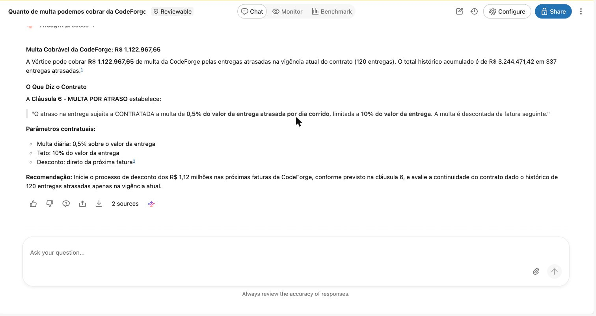
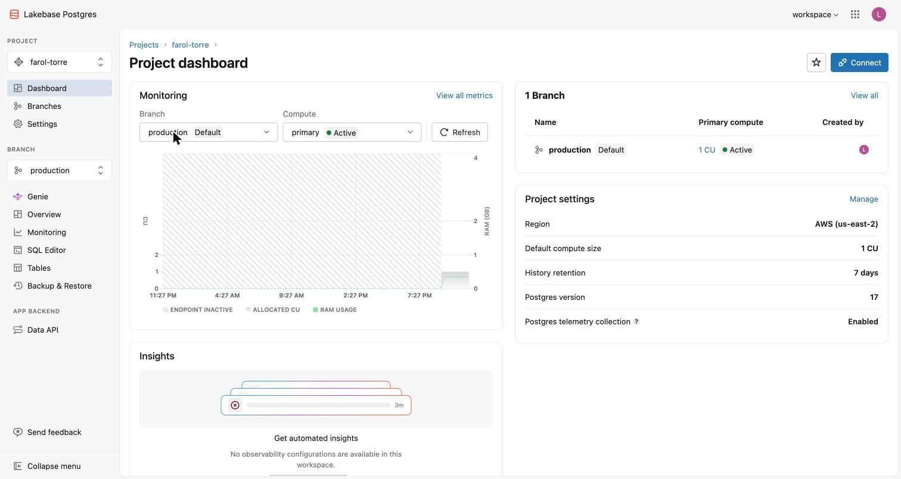
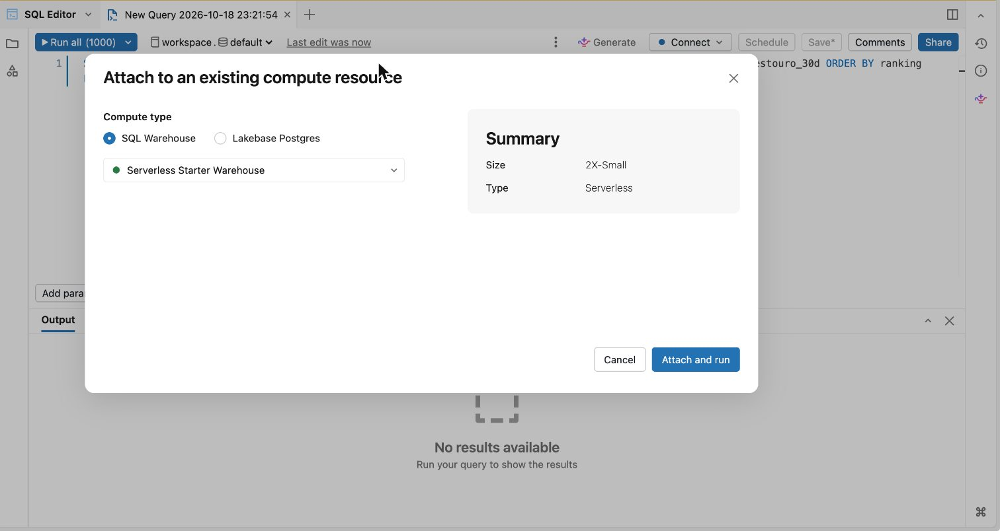

# 🤖 Noite 4 · Engenheiro de IA | Imersão Databricks + Claude Code

> **Quinta, 22/10, 19h30** · 📺 gravação: _link após a live_
>
> **Pergunta da noite:** *"E o dono, que não escreve SQL?"*
> **Formato:** 3 prompts no Claude Code, 3 deploys, 1 pitch.

## O que você terá ao fim da noite

1. **Um agente que lê contrato** e responde em português, citando a cláusula.
2. **O app do Projeto Farol**, uma URL que o dono abre no celular, com login do workspace.
3. **Um botão Aprovar** que grava a decisão num banco (Lakebase), com o seu e-mail e o horário.
4. **O pitch de 3 minutos** para pedir o piloto ao dono ([`pitch.md`](pitch.md)).

**Por que isso fecha a história.** Nas noites 1 a 3 você respondeu as 4 perguntas do dono, mas as
respostas estão num SQL Editor que ele nunca vai abrir. Hoje não tem análise nova: a gold já está pronta.
O trabalho é **entregar**. Um dado que só o time de dados consegue abrir não existe para a empresa.

| Noite | O que ficou de pé | O que era preciso saber |
|---|---|---|
| 1 | as 3 ferramentas no catálogo, SPI e CPI | SQL |
| 2 | pipeline, IA nos status, KPIs governados, dashboard, Genie | engenharia de dados |
| 3 | a probabilidade de estouro em 30 dias | ciência de dados |
| **4** | **o app, o agente de contratos e a aprovação** | **nada** |

| Pergunta do dono | Onde a noite 4 responde |
|---|---|
| Quais projetos estão atrasados, e de quais clientes? | app → **Projetos em risco** |
| Quanto esse atraso vai me custar? | app (estouro) + agente (multa que dá para **cobrar** do fornecedor) |
| Tenho gente parada enquanto outro projeto pede gente? | agente + **Simulador** (COL0017 → PRJ-011) |
| O que vai dar errado no próximo mês, e o que eu faço agora? | score da noite 3 (**Alto risco em 30 dias**) + avisos prévios dos contratos + **Aprovar** |

---

## 🧭 O caso da noite: o PRJ-011 e a SRE parada

Um caso só atravessa a noite inteira. Guarde estes quatro passos:

1. **O dono pergunta:** *"Por que o PRJ-011 atrasou?"*
2. **O agente responde:** falta de SRE, reportada em **12 semanas** de status, com **57 dias** de impacto
   nos últimos 90 dias. A causa vem do texto livre do status semanal, que a IA da noite 2 transformou em coluna.
3. **O dono continua:** *"Tenho SRE parado que poderia ir para o PRJ-011?"* → **COL0017 e COL0018**, SREs
   seniores no **PRJ-007** (ainda no discovery), com uso de 5 a 6%: R$ 179,5 mil pagos em 12 semanas sem produzir.
4. **O app fecha:** no **Simulador**, COL0017 → PRJ-011 mostra **19,0 dias** de cronograma recuperados e
   **R$ 22,1 mil** de saldo no mês. O dono clica **Aprovar**, e a decisão vira uma linha no banco.

Cada prompt constrói uma parte desse caminho: o prompt 1 dá os passos 1 a 3, o prompt 2 dá a tela, o prompt 3 dá o clique.

---

## 📖 As palavras novas da noite

| Termo | Em uma frase |
|---|---|
| **`ai_parse_document`** | função SQL que lê um PDF e devolve os pedaços dele (título, cabeçalho de seção, texto), um por linha. |
| **`ai_extract`** | função SQL que tira campos de um texto. **Com um JSON schema** (a lista de campos com o tipo de cada um) ela devolve número de verdade: `0.5`, não `"0,5% ao dia"`. |
| **`ai_query`** | função SQL que manda um texto livre para um modelo de IA e devolve a resposta. Mais flexível que o `ai_extract`, menos previsível. Hoje não usamos: sabemos quais campos queremos do contrato, então o `ai_extract` basta. |
| **Genie (Genie Agent)** | o "chat com os dados" do Databricks: você pergunta em português, ele escreve o SQL nas tabelas que você liberou e responde. Dá para ver o SQL de cada resposta. |
| **Databricks App** | um site que roda dentro do Databricks, com o login da empresa. Ninguém precisa de senha nova. |
| **Lakebase** | um banco **Postgres** gerenciado pelo Databricks. Postgres é o banco feito para gravar uma linha por clique, na hora. |
| **Service principal** | o "usuário robô" do app. Ele nasce sem acesso a nada: você dá as permissões com `GRANT`. |
| **OAuth "Authorize"** | no primeiro acesso, o app pede licença para agir em seu nome (por exemplo, perguntar ao Genie como você). Cada pessoa clica **Authorize** uma vez. |

> **Por que o agente é um Genie, e não um Knowledge Assistant?** No Free Edition, Knowledge Assistant e
> Supervisor Agent viraram *legacy* e não criam mais ("use Genie Agents instead"). O nosso agente é um
> Genie com os contratos guardados numa tabela, com o texto das cláusulas junto. Ele **cita** a fonte porque a
> fonte está na linha do contrato, e dá para auditar o SQL.

---

## 🏛️ Arquitetura

```
                ┌──────────────── noite 4 ────────────────────────────────────────────────────┐
 8 contratos PDF┼─ ai_parse_document ─▶ silver.documentos_elementos                           │
 (no volume)    │      agrupar ─────────▶ silver.contratos_clausulas (72)                       │
                │      ai_extract + JSON schema ─▶ gold.contratos (8 linhas, colunas tipadas)   │
                │      multa e aviso prévio = consultas (gold.contratos + entregas_fornecedor) │
 gold (noite 2) ┼─ projeto_situacao_atual · status_estruturado · utilizacao_pessoa_semana ─┐   │
 score (noite 3)┼─ score_estouro_30d ─────────────────────────────────────────────────┐   │   │
                │                                                                     ▼   ▼   │
                │   Genie Agent "Farol · Diretoria + Contratos" ◀── 6 tabelas + mv_projetos   │
                │          ▲                                                                  │
                │          │ aba Perguntar                                                    │
                │   App "Projeto Farol" (Databricks App · AppKit · login SSO)                 │
                │     leitura ── config/queries/*.sql ── SQL warehouse (gold)                 │
                │     escrita ── POST /api/decisoes ──── Lakebase Postgres torre.decisoes     │
                └─────────────────────────────────────────────────────────────────────────────┘
```

Leia assim: **o PDF vira uma linha por contrato** (em cima), **o Genie lê as tabelas** (meio), **o app mostra e grava** (embaixo).
A leitura vai ao SQL warehouse (a gold); a escrita vai ao Lakebase (o Postgres).

---

## 🛠️ Passo a passo

### 0. Antes de começar (5 min)

- Noites 1 e 2 rodadas (bronze, silver, gold, `status_estruturado`). A noite 3 (`gold.score_estouro_30d`)
  é **opcional**: sem ela, o app mostra "—" na probabilidade e o Genie publica sem o score.
- CLI do Databricks (`databricks -v` ≥ 0.250), Node 22+ e Claude Code. As skills do Databricks já vêm no
  repositório (`.claude/skills/`).
- Login: `databricks auth login --profile <perfil>` e ligue o warehouse.
- **O Free Edition aceita no máximo 3 apps.** Rode `databricks apps list --profile <perfil>`; se já houver
  três, apague um que você não usa mais.

**Como usar os prompts.** Abra o arquivo do prompt, copie o bloco da seção **"O prompt"** e cole no Claude Code,
na raiz do repositório, trocando `<perfil>` pelo seu. O Claude Code lê antes o contexto em
[`prd/CLAUDE.md`](prd/CLAUDE.md). Você constrói em [`meu-agente/`](meu-agente) e [`minha-torre/`](minha-torre);
o gabarito pronto está em [`torre-app/`](torre-app).

| # | Entrega | Deploy | Arquivo |
|---|---|---|---|
| 1 | **O agente que lê contrato** | Genie publicado | [`prd/prompt-01-agente-de-contratos.md`](prd/prompt-01-agente-de-contratos.md) |
| 2 | **O app do Farol**: projetos em risco, simulador, perguntar | `apps deploy` | [`prd/prompt-02-app.md`](prd/prompt-02-app.md) |
| 3 | **A aprovação no Lakebase** (e a tela Decisões) | `apps deploy` | [`prd/prompt-03-aprovacao-lakebase.md`](prd/prompt-03-aprovacao-lakebase.md) |

### 1. Prompt 1 · o agente que lê contrato (20 min)

**O problema.** A gold sabe que a CodeForge atrasa, mas não sabe o que o contrato diz. Contrato é PDF, e PDF não é coluna.

**O que o Claude Code faz:**

1. `ai_parse_document` lê os **8 contratos** em PDF e guarda os pedaços em `silver.documentos_elementos`.
   É a chamada cara: roda uma vez e vira tabela.
2. Os pedaços viram **uma linha por cláusula** (`silver.contratos_clausulas`, 72). É isso que faz o agente citar a fonte.
3. `ai_extract` tira os campos de cada contrato para **`gold.contratos`**, uma linha por contrato: valor anual,
   fim da vigência, renovação automática, aviso prévio, multa, teto, SLA, reajuste e o texto das cláusulas.
   Primeiro **sem schema** (volta texto), depois **com schema** (volta número).
4. Duas consultas no fim do mesmo SQL respondem em R$ e em datas: quanto cobrar de multa (com
   `silver.entregas_fornecedor`) e qual contrato renova sozinho se ninguém avisar. São consultas, não tabelas novas.
5. O Genie **"Farol · Diretoria + Contratos"** é publicado com a `gold.contratos` e a gold das noites 2 e 3, e
   testado com 10 perguntas.

**Por que o schema importa:**

| `ai_extract` | Resultado |
|---|---|
| sem schema | `"0,2% do valor da entrega atrasada por dia corrido, limitada a 5%..."` (texto: não dá para somar) |
| com schema | `multa_atraso_pct_dia = 0.2`, `teto_multa_pct = 5.0` (número: dá para somar) |



*O agente responde "quanto podemos cobrar da CodeForge?". Repare em três coisas: o valor em R$
(R$ 1.122.967,65, na vigência atual), a **Cláusula 6** citada palavra por palavra (0,5% ao dia, teto de 10%)
e o "2 sources" embaixo, que mostra de onde veio cada número. Ele também entende que a Vértice **cobra** a
multa, não paga.*

### 2. Prompt 2 · o app da Torre (22 min)

**O problema.** O dono não abre SQL Editor. O Farol precisa de uma URL.

**O que o Claude Code faz:**

1. `databricks apps init` monta o esqueleto do app (React + TypeScript) em uns 10 segundos.
2. As leituras viram arquivos `.sql` em `config/queries/` (KPIs, projetos em risco, pessoas ociosas).
3. Três telas: **Projetos em risco** (KPIs no topo, incluindo **Alto risco em 30 dias**, do score da noite 3), **Simulador** (pessoa ociosa → projeto que precisa) e **Perguntar**
   (o Genie do prompt 1 dentro do app).
4. `bundle deploy` cria o app e o **service principal**. O script `conceder-acesso.sh` dá a ele os `GRANT`
   na gold. Depois, `databricks apps deploy` publica o código.

> **Esperado:** sem os `GRANT`, o deploy falha com `INSUFFICIENT_PERMISSIONS`. Não é bug: é o robô sem
> permissão. Rode o `conceder-acesso.sh` e faça o deploy de novo.

**O primeiro acesso.** Ao abrir a URL, cada pessoa vê uma tela pedindo licença:


*"Permission Requested": o app `farol-torre` pede para agir em seu nome. Repare em "Manage your genie
spaces": é o que deixa a aba Perguntar usar o Genie como você. Clique **Authorize** uma vez; não aparece de novo.*

**O simulador mostra a conta.** O dono não aprova caixa-preta. Para COL0017 → PRJ-011:

- **151 h** no mês (as horas paradas × 4 semanas);
- **R$ 30,1 mil** de ociosidade que deixa de ser paga;
- **19,0 dias** de cronograma recuperados (dias de impacto da falta de SRE nos últimos 90 dias ÷ 90 × 30);
- **R$ 8,0 mil** de onboarding (40 h × custo da hora);
- **saldo de R$ 22,1 mil** no mês.

Os 19 dias ficam fora da conta em R$: sem uma multa ou receita atrelada, dia de cronograma não vira dinheiro.

### 3. Prompt 3 · a aprovação no Lakebase (12 min)

**O problema.** Hoje, mover uma SRE de projeto é decidido por WhatsApp. Ninguém sabe quem aprovou, quando e por quê.

**Por que Postgres e não uma tabela Delta?** Delta é ótima para analisar milhões de linhas. Postgres é feito
para gravar **uma linha por clique**, com leitura imediata. O Lakebase é esse Postgres, dentro do Databricks,
e funciona no Free Edition.

**O que o Claude Code faz:**

1. Cria o projeto Lakebase (`databricks postgres create-project`, uns 7 segundos).
2. Na subida, o app cria o schema `torre` e a tabela `torre.decisoes`.
3. No simulador entram uma justificativa e os botões **Aprovar** e **Recusar**. Cada clique grava uma linha
   com o **e-mail de quem clicou** e o horário.
4. A porta que escreve é a mais vigiada: o servidor recusa projeto fora do padrão `PRJ-000`, pessoa fora de
   `COL0000` e justificativa com menos de 10 caracteres. Há teste automatizado para isso.
5. Uma tela nova, **Decisões**, mostra o histórico.



*O projeto Lakebase do gabarito, `farol-torre` (o seu se chama `minha-torre`). Repare no branch
`production` com o compute **Active**, e em "Postgres version 17": é um Postgres de verdade.*


*Em **Tables**, schema `torre`, a tabela `decisoes` já existe com as colunas `id`, `projeto_origem`,
`projeto_destino`, `recurso_id`, `tipo`... e **"No rows"**. É o estado antes do primeiro clique em Aprovar:
depois dele, a linha aparece aqui.*



*Para conferir pelo navegador: no SQL Editor, em **Connect**, o compute pode ser **SQL Warehouse** (a gold)
ou **Lakebase Postgres** (as decisões). É o mesmo editor para os dois mundos.*

> *"Esta linha é o rótulo de amanhã. Daqui a três meses dá para perguntar: as realocações aprovadas
> melhoraram o SPI do projeto destino? O dado que sai da Torre volta para ela."*

### 4. O pitch (10 min)

Três minutos, uma pergunta ao vivo, um número em reais. O roteiro, a tabela de ROI e as dicas estão em
[`pitch.md`](pitch.md). A demo é o caso da noite: a pergunta do PRJ-011, o simulador e o clique em **Aprovar**.

### Atalho: suba o gabarito inteiro (5 min)

Se atrasou ou quer só ver funcionando:

```bash
bash aulas/aula-04-engenheiro-ia/torre-app/scripts/subir-tudo.sh <perfil>
```

### Confira

```bash
python3 scripts/run_sql.py aulas/aula-04-engenheiro-ia/99-verificacao.sql --profile <perfil>        # 11 × ok
python3 scripts/genie.py benchmark "Farol · Diretoria + Contratos" \
  aulas/aula-04-engenheiro-ia/prd/genie-benchmark.json --profile <perfil>                         # ≥ 8/10
uv run --no-project --with "psycopg[binary]" python \
  aulas/aula-04-engenheiro-ia/torre-app/scripts/ver_decisoes.py --profile <perfil>                # a sua decisão
```

O primeiro confere os números do agente. O segundo faz as 10 perguntas ao Genie. O terceiro lê a sua
decisão **direto do Postgres**, com o seu e-mail, o horário, R$ 30.123,20 e 19,0 dias.

---

## 🔢 O que deve aparecer na tela

| O quê | Valor |
|---|---|
| Contratos lidos / cláusulas | 8 / 72 |
| Contratos sem multa por atraso (só SLA) | 3 |
| `ai_extract` sem schema | `"0,2% do valor da entrega atrasada por dia corrido, limitada a 5%..."` (texto) |
| `ai_extract` com schema | `multa_atraso_pct_dia = 0.2`, `teto_multa_pct = 5.0` (número) |
| Multa da CodeForge | 0,5% ao dia, teto de 10% |
| Multa a cobrar da CodeForge na vigência atual | **R$ 1.122.967,65** (120 entregas atrasadas; R$ 3,24 mi desde 2024) |
| Aviso prévio vencido | DataPrime e NuvemSul (renovaram sozinhos em 01 e 02/10; R$ 21,4 mi por ano) |
| Aviso prévio nos próximos 60 dias | Observa360 (31/10) e QualiTest (01/12, **sem renovação automática**) |
| App: em risco · críticos · melancias · estouro | **17 de 41** · 7 · 4 · **R$ 6,5 mi** |
| App: multa a cobrar · alto risco em 30 dias | R$ 1,2 mi (todos os fornecedores) · 18 (faixa alta no score da noite 3) |
| Simulador COL0017 (PRJ-007) → PRJ-011 | 151 h no mês · R$ 30,1 mil de ociosidade evitada · **19,0 dias** recuperados · onboarding R$ 8,0 mil · saldo R$ 22,1 mil |
| Aprovar COL0017 → PRJ-011 | "Decisão nº 1 aprovada e registrada por <seu e-mail>" |
| Benchmark do Genie | **≥ 8/10** (10/10 no ensaio de 18/10, antes da simplificação) |

### A pergunta-âncora, o que o Genie deve responder

> *"O PRJ-011 atrasou por **falta de SRE**, reportada em **12 semanas** de status nos últimos 90 dias, com
> **57 dias** de impacto no cronograma."*

---

## ⏱️ Roteiro da noite (75 min úteis)

| Bloco | Min | O quê |
|---|---:|---|
| Abertura | 8 | o arco das 4 noites; as 4 perguntas do dono; "e quem não escreve SQL?" |
| Prompt 1 · contratos + Genie | 20 | abrir o PDF da CodeForge, colar o prompt, mostrar o ai_extract sem e com schema; a pergunta-âncora |
| Prompt 2 · o app | 22 | `apps list` (limite de 3), `apps init`, as queries, o GRANT ao vivo, o deploy, a URL |
| Prompt 3 · aprovação | 12 | Lakebase em 7 s, o botão, a linha no Postgres |
| Pitch | 10 | os 3 minutos, ao vivo, com a demo da pergunta |
| Fecho | 3 | publicar: GitHub + vídeo + LinkedIn ([`pitch.md`](pitch.md#checklist-de-publicação)) |

**Se atrasar:** o prompt 3 vira demonstração (rode `subir-tudo.sh` antes da aula). Nunca corte o pitch.

---

## 🧯 Se der errado

| Sintoma | Causa | O que fazer |
|---|---|---|
| `Knowledge Assistant is now a legacy feature` | o Free Edition não cria mais KA nem Supervisor | é o motivo do agente ser um Genie |
| Genie: "a Vértice deve pagar a multa" | o modelo não sabe quem é a contratante | instrução explícita (já está no `gerar_genie.py`) |
| Publicar Genie: `score_estouro_30d does not exist` | noite 3 não rodou ou está recriando a tabela | rode o gerador de novo: ele só inclui o score se existir |
| Sobrescreveu o Genie da noite 2 | publicou com o título "Farol · Diretoria" | use "Farol · Diretoria + Contratos"; restaure a noite 2 com `bundle deploy` do `vertice` |
| `reached the maximum limit of 3 apps` | o Free Edition aceita 3 apps | apague um app que não usa mais |
| `apps deploy`: `INSUFFICIENT_PERMISSIONS` | service principal sem GRANT | `bash torre-app/scripts/conceder-acesso.sh <perfil>` e deploy de novo |
| `apps validate`: `TABLE_OR_VIEW_NOT_FOUND` | query de `config/queries` com tabela opcional | tabela opcional vai em rota do servidor (`routes/score.ts`) |
| `Requested node type [UNKNOWN] is not supported` | arquivo `*.geniespace.json` dentro do app | renomeie para `*-genie.json` |
| `permission denied for schema torre` | o schema foi criado por você no `npm run dev` | apague o schema `torre` e reinicie o app |
| `A soft-deleted project currently has this resource name` | apagou o Lakebase sem `--purge` | `databricks postgres delete-project projects/<id> --purge` ou `undelete-project` |
| App pede "Permission Requested" | consentimento OAuth (o Genie age em seu nome) | **Authorize**, uma vez |
| Tela com números sem formato | o warehouse devolve número como string | `num()` / `Number()` |

Limpar só a noite 4 para ensaiar de novo (simula; `--apagar` apaga; nunca toca nas noites 1 a 3):

```bash
bash aulas/aula-04-engenheiro-ia/prd/99-limpar-aula-04.sh <perfil>
```

---

## 🗂️ Arquivos

| Arquivo | Para que serve |
|---|---|
| `prd/CLAUDE.md` | contexto que o Claude Code lê antes dos prompts |
| `prd/prompt-0N-*.md` | os 3 prompts, com o que mostrar, o que falar e "se der errado" |
| `prd/genie-benchmark.json` | 10 perguntas com SQL de referência |
| `prd/99-limpar-aula-04.sh` | apaga só a noite 4 |
| `99-verificacao.sql` | 11 checagens esperado × obtido |
| `torre-app/` | o gabarito: app + agente + job + scripts |
| `meu-agente/`, `minha-torre/` | onde você constrói |
| `pitch.md` | o pitch de 3 minutos e o checklist de publicação |
| `APRENDIZADOS.md` | o que falhou no ensaio e como foi resolvido |
| Slides | [`slides/imersao.html`](../../slides/imersao.html), seção da noite 4 (abra no navegador, ← → navega, F tela cheia) |
